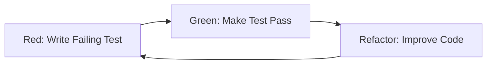

# Test-Driven Development (TDD) Pattern

Write the failing test first, make it pass with the smallest change, then refactor with the tests green. The test projects, fixtures, and attributes this pattern uses are described in `.ai/patterns/testing-patterns.md`. This file covers the cycle and the decisions inside it.

## The cycle



1. **Red.** Write one test for the next behaviour. Run it and see it fail for the reason you expect (a missing type, a wrong result), not a typo.
2. **Green.** Write the least code that passes. Hard-coding is acceptable here; the next test forces the general case.
3. **Refactor.** With every test green, remove duplication and clarify names. Run the tests after each change.

Keep the loop short: minutes, not hours. If a red test needs more than one new type, split the test.

## Test-first on a CQRS handler

Start from the behaviour a use case states, not from the implementation. For a command that creates an entity:

```csharp
// RED: the command and handler do not exist yet, so this does not compile. That is the first failure.
[TestMethod]
[TestCategory("AC-{Domain}-014.1")]
public async Task HandleAsync_ValidCommand_PersistsTheGivenValues()
{
    using var db = new TestDatabase();
    var handler = new Create{Entity}CommandHandler(db.Context, NullLogger<Create{Entity}CommandHandler>.Instance);

    var result = await handler.HandleAsync(new Create{Entity}Command(Name: "Alpha", Description: null));

    var stored = await db.Context.{Entities}.SingleAsync(e => e.{Entity}Id == result.{Entity}Id);
    Assert.AreEqual("Alpha", stored.Name);
}
```

Then the next test drives the refusal path:

```csharp
[TestMethod]
[TestCategory("AC-{Domain}-014.2")]
public async Task HandleAsync_EmptyName_ThrowsArgumentException()
{
    using var db = new TestDatabase();
    var handler = new Create{Entity}CommandHandler(db.Context, NullLogger<Create{Entity}CommandHandler>.Instance);

    await Assert.ThrowsExactlyAsync<ArgumentException>(() =>
        handler.HandleAsync(new Create{Entity}Command(Name: "", Description: null)));
}
```

Use `Assert.ThrowsExactlyAsync` so a subclass or a different exception fails the test. `[ExpectedException]` is not used: it cannot check the message and it hides the line that threw.

## Arrange, Act, Assert

Every test has three visibly separate blocks, marked with comments when the test is longer than a few lines:

```csharp
// Arrange
using var db = new TestDatabase();
var id = await {Entity}TestData.AddAsync(db.Context, name: "Alpha");
var handler = new Get{Entity}ByIdQueryHandler(db.Context, NullLogger<Get{Entity}ByIdQueryHandler>.Instance);

// Act
var result = await handler.HandleAsync(new Get{Entity}ByIdQuery(id));

// Assert
Assert.AreEqual("Alpha", result.{Entity}?.Name);
```

Given-When-Then reads the same way in prose: Given is Arrange, When is Act, Then is Assert. Use it in the story and the acceptance criterion; keep the code in AAA.

## What a unit test may touch

- The handler under test, constructed with the real `DataContext` over InMemory.
- Rows written by the arrange step and read back by the assertion.
- `NullLogger<T>.Instance` for the logger.

Do not mock `DataContext`, `DbSet<T>`, or `ILogger<T>`. A mocked context cannot show that a query translates or that a change is saved. If a handler calls an external service, mock that service's interface only, and say so in the test project file.

## Integration tests

Endpoint tests boot the real API through `WebApplicationFactory<Program>`. They check routing, validation, the handler, and the status codes together:

```csharp
[TestMethod]
[TestCategory("AC-{Domain}-014.3")]
public async Task Create_ValidRequest_ThenGetById_ReturnsTheCreatedItem()
{
    await using var factory = new CustomWebApplicationFactory();
    using var client = factory.CreateClient();

    using var create = await client.PostAsJsonAsync("/{entities}", new { name = "Alpha", description = "First sample" });
    Assert.AreEqual(HttpStatusCode.Created, create.StatusCode);

    var id = JsonSerializer.Deserialize<Guid>(await create.Content.ReadAsStringAsync());
    using var fetch = await client.GetAsync($"/{entities}/{id}");

    Assert.AreEqual(HttpStatusCode.OK, fetch.StatusCode);
}
```

Integration tests run slower than handler tests. Keep one happy path and one refusal per route, and put the rest in the handler tests.

## Acceptance tests

Acceptance tests are written from the story's acceptance criteria in Gherkin. The Reqnroll project is the `tests-acceptance` option, which the generator does not write yet. When it is added, each scenario carries its criterion as a tag, and the step definitions call the same handlers the unit tests call.

```gherkin
@AC-{Domain}-014.1
Scenario: Create a new {entity}
  Given I am a signed-in user
  When I create a {entity} named "Alpha"
  Then the {entity} is listed with the name "Alpha"
```

## Traceability

A test that is evidence for an acceptance criterion says so twice: the file header lists the criteria, and the method carries one category. The rule and the validator are in `.ai/reference/traceability.md` and `.ai/tests/validate-traceability.py`.

```csharp
// Traces: US-{Domain}-014 / AC-{Domain}-014.1, AC-{Domain}-014.2

[TestMethod]
[TestCategory("AC-{Domain}-014.1")]
public async Task HandleAsync_ValidCommand_PersistsTheGivenValues()
```

A test that checks a guard clause, a log line, or infrastructure has no `AC-` category. It stays outside the trace.

## Coverage is a symptom, not the target

Coverage shows which lines ran. It does not show whether the assertions would catch a regression. Read the assertions before reading the number. Mutation-style questions help: if the handler forgot to save, would a test fail? If the query returned every row, would a test fail?

## Anti-patterns

**Testing the implementation.** A test that asserts a private field, or verifies a call sequence on a mock, breaks on every refactor and proves nothing about behaviour.

```csharp
// WRONG: asserts how the handler works, not what it produces
dataContextMock.Verify(x => x.Items.Add(It.IsAny<Item>()), Times.Once);

// CORRECT: asserts the stored outcome
var stored = await db.Context.Items.SingleAsync(e => e.ItemId == result.ItemId);
Assert.AreEqual("Alpha", stored.Name);
```

**Shared state between tests.** A static list or a shared database makes order matter. Each test creates its own `TestDatabase`.

**Sleeps and timing.** Use cancellation tokens and deterministic inputs. Pass `DateTimeOffset` values in when the time matters.

**Assertion-free tests.** A test that only calls the handler passes even when the handler is wrong. Every test asserts an outcome.

## Quality checklist

- [ ] Each test starts from a behaviour, not from a class
- [ ] The test failed for the expected reason before the code was written
- [ ] Handler tests use `TestDatabase` (real `DataContext`, InMemory), not a mock
- [ ] Refusals use `Assert.ThrowsExactly` or `Assert.ThrowsExactlyAsync`, not `[ExpectedException]`
- [ ] Each test asserts an outcome and runs independently of the others
- [ ] Evidence tests carry `// Traces:` and one `[TestCategory("AC-…")]` per method
