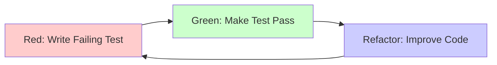

# Test-Driven Development (TDD) Pattern

## Overview

Test-Driven Development (TDD) is a software development methodology where tests are written before the actual code. The TDD cycle follows a simple mantra: **Red-Green-Refactor**. This approach ensures code correctness, improves design, provides living documentation, and increases developer confidence.

---

## The TDD Cycle: Red-Green-Refactor



### 1. RED - Write a Failing Test

Write a test for the next bit of functionality you want to add. The test should fail because the functionality doesn't exist yet.

```csharp
// File: tests/{ApplicationName}.{Domain}.Tests/Handlers/Create{Entity}CommandHandlerTests.cs

using Microsoft.VisualStudio.TestTools.UnitTesting;

[TestClass]
public sealed class Create{Entity}CommandHandlerTests
{
    [TestMethod]
    public async Task HandleAsync_ValidCommand_Creates{Entity}()
    {
        // This test will FAIL because Create{Entity}CommandHandler doesn't exist yet
        var handler = new Create{Entity}CommandHandler();
        var command = new Create{Entity}Command("Test {Entity}", 1000m, DateTimeOffset.UtcNow);

        var result = await handler.HandleAsync(command);

        Assert.IsNotNull(result);
        Assert.AreNotEqual(Guid.Empty, result.{Entity}Id);
    }
}

// ❌ RED: Test fails - Create{Entity}CommandHandler doesn't exist
```

### 2. GREEN - Make the Test Pass

Write the minimum amount of code necessary to make the test pass. Don't worry about perfect code yet.

```csharp
// File: {ApplicationName}.Domain.{Domain}/Features/{Entity}/Commands/Create{Entity}Command.cs

public sealed record Create{Entity}Command(
    string Name,
    decimal Amount,
    DateTimeOffset StartDate
) : ICommand<Create{Entity}Response>;

public sealed record Create{Entity}Response(Guid {Entity}Id);

// File: {ApplicationName}.Domain.{Domain}/Features/{Entity}/Commands/Create{Entity}CommandHandler.cs

public sealed class Create{Entity}CommandHandler : ICommandHandler<Create{Entity}Command, Create{Entity}Response>
{
    public async Task<Create{Entity}Response> HandleAsync(
        Create{Entity}Command command,
        CancellationToken cancellationToken = default)
    {
        // Minimum code to make test pass
        var {entity}Id = Guid.NewGuid();
        return new Create{Entity}Response({entity}Id);
    }
}

// ✅ GREEN: Test passes - handler returns an identifier
```

### 3. REFACTOR - Improve the Code

Now that the test passes, refactor the code to improve its design without changing its behavior.

```csharp
// File: {ApplicationName}.Domain.{Domain}/Features/{Entity}/Commands/Create{Entity}CommandHandler.cs

public sealed class Create{Entity}CommandHandler(
    DataContext dataContext,
    ILogger<Create{Entity}CommandHandler> logger
) : ICommandHandler<Create{Entity}Command, Create{Entity}Response>
{
    public async Task<Create{Entity}Response> HandleAsync(
        Create{Entity}Command command,
        CancellationToken cancellationToken = default)
    {
        // Refactored: Proper implementation with validation, logging, persistence
        ArgumentNullException.ThrowIfNull(command);
        ArgumentException.ThrowIfNullOrWhiteSpace(command.Name, nameof(command.Name));

        if (command.Amount <= 0)
            throw new ArgumentException("Amount must be positive", nameof(command.Amount));

        logger.LogInformation(
            "Creating {EntityType} with Name: {Name}",
            nameof({Entity}), command.Name);

        var entity = new Entities.{Entities}.{Entity}
        {
            {Entity}Id = Guid.NewGuid(),
            Name = command.Name,
            Amount = command.Amount,
            StartDate = command.StartDate
        };

        dataContext.{Entities}.Add(entity);
        var rowsAffected = await dataContext.SaveChangesAsync(cancellationToken);

        if (rowsAffected == 0)
            throw new InvalidOperationException("Failed to create {entity}");

        logger.LogInformation(
            "Created {EntityType} with ID: {EntityId}",
            nameof({Entity}), entity.{Entity}Id);

        return new Create{Entity}Response(entity.{Entity}Id);
    }
}

// ✅ REFACTOR: Code improved, tests still pass
```

---

## Writing Tests First (Test-First Development)

### The Test-First Workflow

1. **Understand the requirement**
2. **Write a test** that describes the behavior
3. **Run the test** - it should fail (RED)
4. **Write the code** to make the test pass (GREEN)
5. **Refactor** the code (REFACTOR)
6. **Repeat** for the next requirement

### Example: Implementing {Entity} Validation

**Requirement:** {Entity} name must be between 3 and 100 characters.

**Step 1: Write Test for Empty Name**
```csharp
[TestMethod]
[ExpectedException(typeof(ArgumentException))]
public async Task HandleAsync_EmptyName_ThrowsArgumentException()
{
    // Arrange
    var handler = CreateHandler();
    var command = new Create{Entity}Command("", 1000m, DateTimeOffset.UtcNow);

    // Act
    await handler.HandleAsync(command);

    // Assert - Exception expected
}
```

**Step 2: Make Test Pass**
```csharp
public async Task<Create{Entity}Response> HandleAsync(
    Create{Entity}Command command,
    CancellationToken cancellationToken = default)
{
    ArgumentException.ThrowIfNullOrWhiteSpace(command.Name, nameof(command.Name));

    // Rest of implementation...
}
```

**Step 3: Write Test for Name Too Short**
```csharp
[TestMethod]
[ExpectedException(typeof(ArgumentException))]
public async Task HandleAsync_NameTooShort_ThrowsArgumentException()
{
    // Arrange
    var handler = CreateHandler();
    var command = new Create{Entity}Command("AB", 1000m, DateTimeOffset.UtcNow);

    // Act
    await handler.HandleAsync(command);

    // Assert - Exception expected
}
```

**Step 4: Implement Validation**
```csharp
public async Task<Create{Entity}Response> HandleAsync(
    Create{Entity}Command command,
    CancellationToken cancellationToken = default)
{
    ArgumentException.ThrowIfNullOrWhiteSpace(command.Name, nameof(command.Name));

    if (command.Name.Length < 3 || command.Name.Length > 100)
        throw new ArgumentException(
            "Name must be between 3 and 100 characters",
            nameof(command.Name));

    // Rest of implementation...
}
```

---

## Test Structure: Arrange-Act-Assert (AAA)

### AAA Pattern

Every test should be organized into three clear sections:

1. **Arrange** - Set up test data and dependencies
2. **Act** - Execute the code under test
3. **Assert** - Verify the results

```csharp
[TestMethod]
public async Task HandleAsync_ValidCommand_Creates{Entity}()
{
    // ARRANGE - Set up test data and mocks
    var dataContextMock = new Mock<DataContext>();
    var loggerMock = new Mock<ILogger<Create{Entity}CommandHandler>>();
    var handler = new Create{Entity}CommandHandler(
        dataContextMock.Object,
        loggerMock.Object);

    var command = new Create{Entity}Command(
        Name: "Test {Entity}",
        Amount: 1000m,
        StartDate: DateTimeOffset.UtcNow);

    // ACT - Execute the method under test
    var result = await handler.HandleAsync(command);

    // ASSERT - Verify the results
    Assert.IsNotNull(result);
    Assert.AreNotEqual(Guid.Empty, result.{Entity}Id);

    dataContextMock.Verify(
        x => x.SaveChangesAsync(It.IsAny<CancellationToken>()),
        Times.Once);
}
```

### Given-When-Then (BDD Style)

An alternative structure popular in Behavior-Driven Development:

```csharp
[TestMethod]
public async Task Create{Entity}_WhenNameIsTooShort_ThenThrowsException()
{
    // GIVEN a {entity} with name too short
    var handler = CreateHandler();
    var command = new Create{Entity}Command("AB", 1000m, DateTimeOffset.UtcNow);

    // WHEN creating the {entity}
    var act = async () => await handler.HandleAsync(command);

    // THEN it should throw ArgumentException
    await Assert.ThrowsExceptionAsync<ArgumentException>(act);
}
```

---

## Unit Testing in TDD

### Characteristics of Good Unit Tests

1. **Fast** - Run in milliseconds
2. **Isolated** - No dependencies on external systems
3. **Repeatable** - Same result every time
4. **Self-Validating** - Pass or fail, no manual verification
5. **Timely** - Written before production code

### Unit Test Example with Mocking

```csharp
// File: tests/{ApplicationName}.{Domain}.Tests/Handlers/Update{Entity}CommandHandlerTests.cs

using Microsoft.VisualStudio.TestTools.UnitTesting;
using Moq;

[TestClass]
public sealed class Update{Entity}CommandHandlerTests
{
    private Mock<DataContext> _dataContextMock;
    private Mock<ILogger<Update{Entity}CommandHandler>> _loggerMock;
    private Update{Entity}CommandHandler _handler;

    [TestInitialize]
    public void Setup()
    {
        _dataContextMock = new Mock<DataContext>();
        _loggerMock = new Mock<ILogger<Update{Entity}CommandHandler>>();
        _handler = new Update{Entity}CommandHandler(
            _dataContextMock.Object,
            _loggerMock.Object);
    }

    [TestMethod]
    public async Task HandleAsync_ValidCommand_Updates{Entity}()
    {
        // Arrange
        var {entity}Id = Guid.NewGuid();
        var existing{Entity} = new {Entity}
        {
            {Entity}Id = {entity}Id,
            Name = "Old Name",
            Amount = 500m,
            StartDate = DateTimeOffset.UtcNow
        };

        var {entities}Mock = new[] { existing{Entity} }.AsQueryable().BuildMockDbSet();
        _dataContextMock
            .Setup(x => x.{Entities})
            .Returns({entities}Mock.Object);

        var command = new Update{Entity}Command({entity}Id, "New Name", 1000m);

        // Act
        var result = await _handler.HandleAsync(command);

        // Assert
        Assert.IsTrue(result.Success);

        _dataContextMock.Verify(
            x => x.SaveChangesAsync(It.IsAny<CancellationToken>()),
            Times.Once);
    }

    [TestMethod]
    public async Task HandleAsync_NegativeAmount_ThrowsArgumentException()
    {
        // Arrange
        var command = new Update{Entity}Command(Guid.NewGuid(), "{Entity}", -100m);

        // Act & Assert
        await Assert.ThrowsExceptionAsync<ArgumentException>(
            async () => await _handler.HandleAsync(command));
    }

    [TestMethod]
    public async Task HandleAsync_NonExistent{Entity}_ThrowsNotFoundException()
    {
        // Arrange
        var {entity}Id = Guid.NewGuid();

        var {entities}Mock = new List<{Entity}>().AsQueryable().BuildMockDbSet();
        _dataContextMock
            .Setup(x => x.{Entities})
            .Returns({entities}Mock.Object);

        var command = new Update{Entity}Command({entity}Id, "{Entity}", 1000m);

        // Act & Assert
        await Assert.ThrowsExceptionAsync<NotFoundException>(
            async () => await _handler.HandleAsync(command));
    }
}
```

---

## Integration Testing in TDD

### Integration Test Characteristics

- Test interactions between components
- May use real database (in-memory or test database)
- Test API endpoints end-to-end
- Slower than unit tests but more comprehensive

### Integration Test Example

```csharp
// File: tests/{ApplicationName}.{Domain}.Tests/Integration/{Entity}EndpointsTests.cs

using Microsoft.AspNetCore.Mvc.Testing;
using Microsoft.EntityFrameworkCore;
using Microsoft.VisualStudio.TestTools.UnitTesting;

[TestClass]
public sealed class {Entity}EndpointsTests
{
    private WebApplicationFactory<Program> _factory;
    private HttpClient _client;
    private DataContext _dbContext;

    [TestInitialize]
    public void Setup()
    {
        _factory = new WebApplicationFactory<Program>()
            .WithWebHostBuilder(builder =>
            {
                builder.ConfigureServices(services =>
                {
                    // Replace real database with in-memory database
                    var descriptor = services.SingleOrDefault(
                        d => d.ServiceType == typeof(DbContextOptions<DataContext>));

                    if (descriptor != null)
                        services.Remove(descriptor);

                    services.AddDbContext<DataContext>(options =>
                    {
                        options.UseInMemoryDatabase("TestDb");
                    });

                    var sp = services.BuildServiceProvider();
                    _dbContext = sp.GetRequiredService<DataContext>();
                    _dbContext.Database.EnsureCreated();
                });
            });

        _client = _factory.CreateClient();
    }

    [TestCleanup]
    public void Cleanup()
    {
        _dbContext?.Database.EnsureDeleted();
        _dbContext?.Dispose();
        _client?.Dispose();
        _factory?.Dispose();
    }

    [TestMethod]
    public async Task POST_{Entity}_ReturnsCreated{Entity}()
    {
        // Arrange
        var request = new
        {
            Name = "Test {Entity}",
            Amount = 1000m,
            StartDate = DateTimeOffset.UtcNow
        };

        // Act
        var response = await _client.PostAsJsonAsync("/api/{entities}", request);

        // Assert
        Assert.AreEqual(HttpStatusCode.Created, response.StatusCode);

        var result = await response.Content.ReadFromJsonAsync<Create{Entity}Response>();
        Assert.IsNotNull(result);
        Assert.AreNotEqual(Guid.Empty, result.{Entity}Id);
    }

    [TestMethod]
    public async Task GET_{Entity}ById_ReturnsCorrect{Entity}()
    {
        // Arrange - Create a {entity} first
        var createRequest = new
        {
            Name = "Test {Entity}",
            Amount = 1000m,
            StartDate = DateTimeOffset.UtcNow
        };

        var createResponse = await _client.PostAsJsonAsync("/api/{entities}", createRequest);
        var created{Entity} = await createResponse.Content.ReadFromJsonAsync<Create{Entity}Response>();

        // Act
        var getResponse = await _client.GetAsync($"/api/{entities}/{created{Entity}.{Entity}Id}");

        // Assert
        Assert.AreEqual(HttpStatusCode.OK, getResponse.StatusCode);

        var {entity} = await getResponse.Content.ReadFromJsonAsync<{Entity}Response>();
        Assert.IsNotNull({entity});
        Assert.AreEqual(created{Entity}.{Entity}Id, {entity}.{Entity}Id);
        Assert.AreEqual("Test {Entity}", {entity}.Name);
        Assert.AreEqual(1000m, {entity}.Amount);
    }

    [TestMethod]
    public async Task DELETE_{Entity}_Removes{Entity}()
    {
        // Arrange - Create a {entity}
        var createRequest = new
        {
            Name = "Test {Entity}",
            Amount = 1000m,
            StartDate = DateTimeOffset.UtcNow
        };

        var createResponse = await _client.PostAsJsonAsync("/api/{entities}", createRequest);
        var created{Entity} = await createResponse.Content.ReadFromJsonAsync<Create{Entity}Response>();

        // Act - Delete the {entity}
        var deleteResponse = await _client.DeleteAsync($"/api/{entities}/{created{Entity}.{Entity}Id}");

        // Assert - Delete succeeded
        Assert.AreEqual(HttpStatusCode.NoContent, deleteResponse.StatusCode);

        // Verify {entity} is gone
        var getResponse = await _client.GetAsync($"/api/{entities}/{created{Entity}.{Entity}Id}");
        Assert.AreEqual(HttpStatusCode.NotFound, getResponse.StatusCode);
    }
}
```

---

## Acceptance Testing with Reqnroll

### Gherkin Feature Files

Gherkin provides a business-readable syntax for defining behavior.

```gherkin
# File: tests/{ApplicationName}.{Domain}.Tests/Features/{Entity}Management.feature

Feature: {Entity} Management
  As a user
  I want to manage my {entities}
  So that I can manage my {entities}

  Background:
    Given I am an authenticated user

  Scenario: Create a new {entity}
    When I create a {entity} with the following details:
      | Name         | Amount | StartDate  |
      | Example      | 10000  | 2025-01-01 |
    Then the {entity} should be created successfully
    And the {entity} should have a unique identifier
    And the {entity} should be retrievable by its identifier

  Scenario: Cannot create {entity} with negative amount
    When I attempt to create a {entity} with amount -1000
    Then the creation should fail with a validation error
    And the error message should indicate the amount must be positive

  Scenario: Update {entity} name and amount
    Given a {entity} exists with name "Original {Entity}" and amount 5000
    When I update the {entity} name to "Updated {Entity}" and amount to 7000
    Then the {entity} should be updated successfully
    And the {entity} name should be "Updated {Entity}"
    And the {entity} amount should be 7000

  Scenario: Delete a {entity}
    Given a {entity} exists with name "Old {Entity}"
    When I delete the {entity}
    Then the {entity} should be deleted successfully
    And the {entity} should no longer be retrievable

  Scenario: Get list of {entities} with pagination
    Given the following {entities} exist:
      | Name      | Amount |
      | {Entity} 1  | 1000   |
      | {Entity} 2  | 2000   |
      | {Entity} 3  | 3000   |
      | {Entity} 4  | 4000   |
      | {Entity} 5  | 5000   |
    When I request page 1 with page size 3
    Then I should receive 3 {entities}
    And the {entities} should be ordered by creation date descending

  Scenario: Search {entities} by name
    Given the following {entities} exist:
      | Name            | Amount |
      | Example 1  | 10000  |
      | Example 2  | 12000  |
      | Example 3  | 5000   |
    When I search for {entities} with term "Example"
    Then I should receive 3 {entities}
    And all {entity} names should contain "2025"
```

### Step Definitions

```csharp
// File: tests/{ApplicationName}.{Domain}.Tests/Steps/{Entity}ManagementSteps.cs

using Reqnroll;
using Microsoft.VisualStudio.TestTools.UnitTesting;

[Binding]
public sealed class {Entity}ManagementSteps
{
    private readonly ScenarioContext _scenarioContext;
    private readonly HttpClient _client;
    private HttpResponseMessage? _response;
    private Create{Entity}Response? _created{Entity};
    private {Entity}Response? _retrieved{Entity};
    private List<{Entity}Response>? _{entity}List;

    public {Entity}ManagementSteps(
        ScenarioContext scenarioContext,
        HttpClient client)
    {
        _scenarioContext = scenarioContext;
        _client = client;
    }

    [Given(@"I am an authenticated user")]
    public void GivenIAmAnAuthenticatedUser()
    {
        // Set up authentication token
        _client.DefaultRequestHeaders.Authorization =
            new AuthenticationHeaderValue("Bearer", "test-token");
    }

    [When(@"I create a {entity} with the following details:")]
    public async Task WhenICreate{Entity}WithDetails(Table table)
    {
        var row = table.Rows[0];
        var request = new
        {
            Name = row["Name"],
            Amount = decimal.Parse(row["Amount"]),
            StartDate = DateTimeOffset.Parse(row["StartDate"])
        };

        _response = await _client.PostAsJsonAsync("/api/{entities}", request);

        if (_response.IsSuccessStatusCode)
        {
            _created{Entity} = await _response.Content.ReadFromJsonAsync<Create{Entity}Response>();
            _scenarioContext["Created{Entity}Id"] = _created{Entity}!.{Entity}Id;
        }
    }

    [When(@"I attempt to create a {entity} with amount (.*)")]
    public async Task WhenIAttemptToCreate{Entity}WithAmount(decimal amount)
    {
        var request = new
        {
            Name = "Test {Entity}",
            Amount = amount,
            StartDate = DateTimeOffset.UtcNow
        };

        _response = await _client.PostAsJsonAsync("/api/{entities}", request);
    }

    [Then(@"the {entity} should be created successfully")]
    public void Then{Entity}ShouldBeCreatedSuccessfully()
    {
        Assert.AreEqual(HttpStatusCode.Created, _response!.StatusCode);
        Assert.IsNotNull(_created{Entity});
    }

    [Then(@"the {entity} should have a unique identifier")]
    public void Then{Entity}ShouldHaveUniqueIdentifier()
    {
        Assert.IsNotNull(_created{Entity});
        Assert.AreNotEqual(Guid.Empty, _created{Entity}.{Entity}Id);
    }

    [Then(@"the {entity} should be retrievable by its identifier")]
    public async Task Then{Entity}ShouldBeRetrievable()
    {
        var {entity}Id = _scenarioContext.Get<Guid>("Created{Entity}Id");
        var getResponse = await _client.GetAsync($"/api/{entities}/{entity}Id");

        Assert.AreEqual(HttpStatusCode.OK, getResponse.StatusCode);

        _retrieved{Entity} = await getResponse.Content.ReadFromJsonAsync<{Entity}Response>();
        Assert.IsNotNull(_retrieved{Entity});
        Assert.AreEqual({entity}Id, _retrieved{Entity}.{Entity}Id);
    }

    [Then(@"the creation should fail with a validation error")]
    public void ThenCreationShouldFailWithValidationError()
    {
        Assert.AreEqual(HttpStatusCode.BadRequest, _response!.StatusCode);
    }

    [Then(@"the error message should indicate the amount must be positive")]
    public async Task ThenErrorMessageShouldIndicateAmountMustBePositive()
    {
        var error = await _response!.Content.ReadAsStringAsync();
        Assert.IsTrue(error.Contains("positive", StringComparison.OrdinalIgnoreCase));
    }

    [Given(@"a {entity} exists with name ""(.*)"" and amount (.*)")]
    public async Task Given{Entity}ExistsWithNameAndAmount(string name, decimal amount)
    {
        var request = new
        {
            Name = name,
            Amount = amount,
            StartDate = DateTimeOffset.UtcNow
        };

        var response = await _client.PostAsJsonAsync("/api/{entities}", request);
        var created = await response.Content.ReadFromJsonAsync<Create{Entity}Response>();

        _scenarioContext["{Entity}Id"] = created!.{Entity}Id;
    }

    [When(@"I update the {entity} name to ""(.*)"" and amount to (.*)")]
    public async Task WhenIUpdate{Entity}NameAndAmount(string newName, decimal newAmount)
    {
        var {entity}Id = _scenarioContext.Get<Guid>("{Entity}Id");
        var request = new
        {
            Name = newName,
            Amount = newAmount
        };

        _response = await _client.PutAsJsonAsync($"/api/{entities}/{entity}Id", request);
    }

    [Then(@"the {entity} should be updated successfully")]
    public void Then{Entity}ShouldBeUpdatedSuccessfully()
    {
        Assert.AreEqual(HttpStatusCode.OK, _response!.StatusCode);
    }

    [Then(@"the {entity} name should be ""(.*)""")]
    public async Task Then{Entity}NameShouldBe(string expectedName)
    {
        var {entity}Id = _scenarioContext.Get<Guid>("{Entity}Id");
        var getResponse = await _client.GetAsync($"/api/{entities}/{entity}Id");
        var {entity} = await getResponse.Content.ReadFromJsonAsync<{Entity}Response>();

        Assert.AreEqual(expectedName, {entity}!.Name);
    }

    [Then(@"the {entity} amount should be (.*)")]
    public async Task Then{Entity}AmountShouldBe(decimal expectedAmount)
    {
        var {entity}Id = _scenarioContext.Get<Guid>("{Entity}Id");
        var getResponse = await _client.GetAsync($"/api/{entities}/{entity}Id");
        var {entity} = await getResponse.Content.ReadFromJsonAsync<{Entity}Response>();

        Assert.AreEqual(expectedAmount, {entity}!.Amount);
    }

    [Given(@"a {entity} exists with name ""(.*)""")]
    public async Task Given{Entity}ExistsWithName(string name)
    {
        await Given{Entity}ExistsWithNameAndAmount(name, 1000m);
    }

    [When(@"I delete the {entity}")]
    public async Task WhenIDelete{Entity}()
    {
        var {entity}Id = _scenarioContext.Get<Guid>("{Entity}Id");
        _response = await _client.DeleteAsync($"/api/{entities}/{entity}Id");
    }

    [Then(@"the {entity} should be deleted successfully")]
    public void Then{Entity}ShouldBeDeletedSuccessfully()
    {
        Assert.AreEqual(HttpStatusCode.NoContent, _response!.StatusCode);
    }

    [Then(@"the {entity} should no longer be retrievable")]
    public async Task Then{Entity}ShouldNoLongerBeRetrievable()
    {
        var {entity}Id = _scenarioContext.Get<Guid>("{Entity}Id");
        var getResponse = await _client.GetAsync($"/api/{entities}/{entity}Id");

        Assert.AreEqual(HttpStatusCode.NotFound, getResponse.StatusCode);
    }

    [Given(@"the following {entities} exist:")]
    public async Task GivenFollowing{Entities}Exist(Table table)
    {
        foreach (var row in table.Rows)
        {
            var request = new
            {
                Name = row["Name"],
                Amount = decimal.Parse(row["Amount"]),
                StartDate = DateTimeOffset.UtcNow
            };

            await _client.PostAsJsonAsync("/api/{entities}", request);
            await Task.Delay(100); // Ensure different creation times
        }
    }

    [When(@"I request page (.*) with page size (.*)")]
    public async Task WhenIRequestPageWithSize(int pageNumber, int pageSize)
    {
        var response = await _client.GetAsync(
            $"/api/{entities}?pageNumber={pageNumber}&pageSize={pageSize}");

        _{entity}List = await response.Content.ReadFromJsonAsync<List<{Entity}Response>>();
    }

    [Then(@"I should receive (.*) {entities}")]
    public void ThenIShouldReceive{Entities}(int expectedCount)
    {
        Assert.IsNotNull(_{entity}List);
        Assert.AreEqual(expectedCount, _{entity}List.Count);
    }

    [Then(@"the {entities} should be ordered by creation date descending")]
    public void Then{Entities}ShouldBeOrderedByCreationDate()
    {
        Assert.IsNotNull(_{entity}List);

        for (int i = 0; i < _{entity}List.Count - 1; i++)
        {
            Assert.IsTrue(_{entity}List[i].CreatedDate >= _{entity}List[i + 1].CreatedDate);
        }
    }

    [When(@"I search for {entities} with term ""(.*)""")]
    public async Task WhenISearchFor{Entities}WithTerm(string searchTerm)
    {
        var response = await _client.GetAsync(
            $"/api/{entities}?searchTerm={searchTerm}");

        _{entity}List = await response.Content.ReadFromJsonAsync<List<{Entity}Response>>();
    }

    [Then(@"all {entity} names should contain ""(.*)""")]
    public void ThenAll{Entity}NamesShouldContain(string term)
    {
        Assert.IsNotNull(_{entity}List);

        foreach (var {entity} in _{entity}List)
        {
            Assert.IsTrue(
                {entity}.Name.Contains(term, StringComparison.OrdinalIgnoreCase),
                $"{Entity} '{entity}.Name}' does not contain '{term}'");
        }
    }
}
```

---

## Mocking Strategies with Moq

### Basic Mocking

```csharp
// Mock a dependency
var dataContextMock = new Mock<DataContext>();

// Setup a DbSet to return a value
var {entities}Mock = new[] { new {Entity} { {Entity}Id = Guid.NewGuid(), Name = "Test" } }
    .AsQueryable().BuildMockDbSet();
dataContextMock
    .Setup(x => x.{Entities})
    .Returns({entities}Mock.Object);

// Verify SaveChangesAsync was called
dataContextMock.Verify(
    x => x.SaveChangesAsync(It.IsAny<CancellationToken>()),
    Times.Once);
```

### Advanced Mocking

```csharp
// Setup with specific argument matching — pre-populate DbSet with known entities
var {entities} = new List<{Entity}>
{
    new() { {Entity}Id = Guid.NewGuid(), Name = "Expected Name", Amount = 100m }
};
var {entities}Mock = {entities}.AsQueryable().BuildMockDbSet();
dataContextMock.Setup(x => x.{Entities}).Returns({entities}Mock.Object);

// Setup to throw exception when entity is not found
var empty{Entities}Mock = new List<{Entity}>().AsQueryable().BuildMockDbSet();
dataContextMock.Setup(x => x.{Entities}).Returns(empty{Entities}Mock.Object);

// Verify SaveChangesAsync was called
dataContextMock.Verify(
    x => x.SaveChangesAsync(It.IsAny<CancellationToken>()),
    Times.Once);

// Verify SaveChangesAsync was never called
dataContextMock.Verify(
    x => x.SaveChangesAsync(It.IsAny<CancellationToken>()),
    Times.Never);
```

---

## Test Coverage vs Test Quality

### Code Coverage

Code coverage measures how much of your code is executed by tests.

```bash
# Run tests with coverage (using coverlet)
dotnet test /p:CollectCoverage=true /p:CoverletOutputFormat=opencover

# Generate coverage report
reportgenerator -reports:coverage.opencover.xml -targetdir:coveragereport
```

### Quality Over Coverage

❌ **WRONG - High coverage, low quality:**
```csharp
[TestMethod]
public async Task TestHandler()
{
    // This test achieves 100% code coverage but doesn't verify anything meaningful
    var handler = new Create{Entity}CommandHandler(null, null);
    try
    {
        await handler.HandleAsync(null!);
    }
    catch
    {
        // Swallow exception
    }
}
```

✅ **CORRECT - Meaningful tests:**
```csharp
[TestMethod]
public async Task HandleAsync_ValidCommand_Creates{Entity}WithCorrectProperties()
{
    // Arrange
    var dataContextMock = new Mock<DataContext>();
    var loggerMock = new Mock<ILogger<Create{Entity}CommandHandler>>();
    var handler = new Create{Entity}CommandHandler(
        dataContextMock.Object,
        loggerMock.Object);

    var command = new Create{Entity}Command("Test {Entity}", 1000m, DateTimeOffset.UtcNow);

    // Act
    var result = await handler.HandleAsync(command);

    // Assert - Verify behavior, not just code execution
    Assert.IsNotNull(result);
    Assert.AreNotEqual(Guid.Empty, result.{Entity}Id);

    dataContextMock.Verify(
        x => x.SaveChangesAsync(It.IsAny<CancellationToken>()),
        Times.Once);
}

[TestMethod]
public async Task HandleAsync_NegativeAmount_ThrowsArgumentException()
{
    // Test edge case
}

[TestMethod]
public async Task HandleAsync_EmptyName_ThrowsArgumentException()
{
    // Test validation
}
```

---

## TDD with MSTest Framework

### MSTest Attributes

```csharp
[TestClass]
public sealed class Create{Entity}CommandHandlerTests
{
    private Mock<DataContext> _dataContextMock;
    private Create{Entity}CommandHandler _handler;

    // Runs once before all tests in the class
    [ClassInitialize]
    public static void ClassSetup(TestContext context)
    {
        // One-time setup for all tests
    }

    // Runs before each test
    [TestInitialize]
    public void TestSetup()
    {
        _dataContextMock = new Mock<DataContext>();
        _handler = new Create{Entity}CommandHandler(_dataContextMock.Object, null!);
    }

    // Runs after each test
    [TestCleanup]
    public void TestCleanup()
    {
        _dataContextMock = null!;
        _handler = null!;
    }

    // Runs once after all tests in the class
    [ClassCleanup]
    public static void ClassTeardown()
    {
        // One-time cleanup
    }

    [TestMethod]
    public async Task TestMethod()
    {
        // Test implementation
    }

    [TestMethod]
    [ExpectedException(typeof(ArgumentException))]
    public async Task TestMethodExpectingException()
    {
        // Test that throws exception
    }

    [TestMethod]
    [Ignore("Temporarily disabled")]
    public async Task IgnoredTest()
    {
        // This test won't run
    }

    [DataTestMethod]
    [DataRow("Name1", 100)]
    [DataRow("Name2", 200)]
    [DataRow("Name3", 300)]
    public async Task TestWithMultipleDataSets(string name, decimal amount)
    {
        // Test runs 3 times with different data
    }
}
```

---

## BDD with Reqnroll/Gherkin

### Gherkin Keywords

- **Feature** - High-level description of functionality
- **Background** - Steps run before each scenario
- **Scenario** - Individual test case
- **Scenario Outline** - Parameterized scenario
- **Given** - Preconditions
- **When** - Actions
- **Then** - Assertions
- **And** - Additional steps
- **But** - Negative assertions

### Scenario Outline Example

```gherkin
Scenario Outline: Create {entities} with different amounts
  When I create a {entity} with name "<name>" and amount <amount>
  Then the {entity} should be created successfully
  And the {entity} name should be "<name>"
  And the {entity} amount should be <amount>

  Examples:
    | name        | amount |
    | Small       | 100    |
    | Medium      | 1000   |
    | Large       | 10000  |
    | Very Large  | 100000 |
```

---

## TDD Workflow Examples

### Example 1: Adding Validation

**Requirement:** {Entity} amount must be greater than zero.

```csharp
// STEP 1: Write failing test (RED)
[TestMethod]
[ExpectedException(typeof(ArgumentException))]
public async Task HandleAsync_ZeroAmount_ThrowsArgumentException()
{
    var handler = CreateHandler();
    var command = new Create{Entity}Command("Test", 0m, DateTimeOffset.UtcNow);

    await handler.HandleAsync(command);
}

// Test fails - no validation exists yet

// STEP 2: Make test pass (GREEN)
public async Task<Create{Entity}Response> HandleAsync(
    Create{Entity}Command command,
    CancellationToken cancellationToken = default)
{
    if (command.Amount <= 0)
        throw new ArgumentException("Amount must be positive", nameof(command.Amount));

    // Rest of implementation...
}

// Test passes

// STEP 3: Refactor (if needed)
// Move validation to a separate method if it grows complex
```

### Example 2: Adding Business Logic

**Requirement:** Calculate remaining {entity} amount.

```csharp
// STEP 1: Write failing test (RED)
[TestMethod]
public void CalculateRemaining_WithSpending_ReturnsCorrectAmount()
{
    var {entity} = new {Entity}
    {
        {Entity}Id = Guid.NewGuid(),
        TotalAmount = 1000m
    };

    var remaining = {entity}.CalculateRemaining(spent: 300m);

    Assert.AreEqual(700m, remaining);
}

// Test fails - method doesn't exist

// STEP 2: Make test pass (GREEN)
public sealed class {Entity}
{
    public Guid {Entity}Id { get; init; }
    public decimal TotalAmount { get; init; }

    public decimal CalculateRemaining(decimal spent)
    {
        return TotalAmount - spent;
    }
}

// Test passes

// STEP 3: Add edge case tests and refactor
[TestMethod]
public void CalculateRemaining_WhenSpentExceeds{Entity}_ReturnsNegative()
{
    var {entity} = new {Entity} { TotalAmount = 1000m };
    var remaining = {entity}.CalculateRemaining(spent: 1200m);

    Assert.AreEqual(-200m, remaining);
}
```

---

## Refactoring in TDD

### Safe Refactoring with Tests

Tests act as a safety net during refactoring. If tests pass after refactoring, behavior is preserved.

**Before Refactoring:**
```csharp
public async Task<Create{Entity}Response> HandleAsync(
    Create{Entity}Command command,
    CancellationToken cancellationToken = default)
{
    if (command == null)
        throw new ArgumentNullException(nameof(command));

    if (string.IsNullOrWhiteSpace(command.Name))
        throw new ArgumentException("Name is required", nameof(command.Name));

    if (command.Name.Length < 3)
        throw new ArgumentException("Name too short", nameof(command.Name));

    if (command.Name.Length > 100)
        throw new ArgumentException("Name too long", nameof(command.Name));

    if (command.Amount <= 0)
        throw new ArgumentException("Amount must be positive", nameof(command.Amount));

    var entity = new Entities.{Entities}.{Entity}
    {
        {Entity}Id = Guid.NewGuid(),
        Name = command.Name,
        Amount = command.Amount,
        StartDate = command.StartDate
    };

    dataContext.{Entities}.Add(entity);
    var rowsAffected = await dataContext.SaveChangesAsync(cancellationToken);

    if (rowsAffected == 0)
        throw new InvalidOperationException("Failed to create {entity}");

    return new Create{Entity}Response(entity.{Entity}Id);
}
```

**After Refactoring:**
```csharp
public async Task<Create{Entity}Response> HandleAsync(
    Create{Entity}Command command,
    CancellationToken cancellationToken = default)
{
    ValidateCommand(command);

    var entity = new Entities.{Entities}.{Entity}
    {
        {Entity}Id = Guid.NewGuid(),
        Name = command.Name,
        Amount = command.Amount,
        StartDate = command.StartDate
    };

    dataContext.{Entities}.Add(entity);
    var rowsAffected = await dataContext.SaveChangesAsync(cancellationToken);

    if (rowsAffected == 0)
        throw new InvalidOperationException("Failed to create {entity}");

    return new Create{Entity}Response(entity.{Entity}Id);
}

private static void ValidateCommand(Create{Entity}Command command)
{
    ArgumentNullException.ThrowIfNull(command);
    ArgumentException.ThrowIfNullOrWhiteSpace(command.Name, nameof(command.Name));

    if (command.Name.Length < 3 || command.Name.Length > 100)
        throw new ArgumentException(
            "Name must be between 3 and 100 characters",
            nameof(command.Name));

    if (command.Amount <= 0)
        throw new ArgumentException(
            "Amount must be positive",
            nameof(command.Amount));
}
```

**All tests still pass - refactoring successful.**

---

## TDD for CQRS Handlers

### Command Handler TDD Example

```csharp
// File: tests/{ApplicationName}.{Domain}.Tests/Handlers/Delete{Entity}CommandHandlerTests.cs

[TestClass]
public sealed class Delete{Entity}CommandHandlerTests
{
    [TestMethod]
    public async Task HandleAsync_Existing{Entity}_DeletesSuccessfully()
    {
        // Arrange
        var {entity}Id = Guid.NewGuid();
        var dataContextMock = new Mock<DataContext>();
        var loggerMock = new Mock<ILogger<Delete{Entity}CommandHandler>>();
        var handler = new Delete{Entity}CommandHandler(
            dataContextMock.Object,
            loggerMock.Object);

        var command = new Delete{Entity}Command({entity}Id);

        var {entities}Mock = new[] { new {Entity} { {Entity}Id = {entity}Id, Name = "Test", Amount = 100m } }
            .AsQueryable().BuildMockDbSet();
        dataContextMock.Setup(x => x.{Entities}).Returns({entities}Mock.Object);

        // Act
        var result = await handler.HandleAsync(command);

        // Assert
        Assert.IsTrue(result.Success);

        dataContextMock.Verify(
            x => x.SaveChangesAsync(It.IsAny<CancellationToken>()),
            Times.Once);
    }

    [TestMethod]
    [ExpectedException(typeof(ArgumentNullException))]
    public async Task HandleAsync_NullCommand_ThrowsArgumentNullException()
    {
        var handler = CreateHandler();
        await handler.HandleAsync(null!);
    }

    [TestMethod]
    [ExpectedException(typeof(NotFoundException))]
    public async Task HandleAsync_NonExistent{Entity}_ThrowsNotFoundException()
    {
        var {entity}Id = Guid.NewGuid();
        var dataContextMock = new Mock<DataContext>();

        var {entities}Mock = new List<{Entity}>().AsQueryable().BuildMockDbSet();
        dataContextMock
            .Setup(x => x.{Entities})
            .Returns({entities}Mock.Object);

        var handler = new Delete{Entity}CommandHandler(dataContextMock.Object, null!);
        var command = new Delete{Entity}Command({entity}Id);

        await handler.HandleAsync(command);
    }
}
```

### Query Handler TDD Example

```csharp
// File: tests/{ApplicationName}.{Domain}.Tests/Handlers/Get{Entities}ListQueryHandlerTests.cs

[TestClass]
public sealed class Get{Entities}ListQueryHandlerTests
{
    [TestMethod]
    public async Task HandleAsync_WithPagination_ReturnsCorrectPage()
    {
        // Arrange
        var {entities} = CreateTest{Entities}(25);
        var dataContextMock = new Mock<DataContext>();

        dataContextMock
            .Setup(x => x.Set<{Entity}>())
            .Returns({entities}.AsQueryable().BuildMockDbSet().Object);

        var handler = new Get{Entities}ListQueryHandler(dataContextMock.Object, null!);
        var query = new Get{Entities}ListQuery(PageNumber: 2, PageSize: 10);

        // Act
        var result = await handler.HandleAsync(query);

        // Assert
        Assert.AreEqual(10, result.Count);
        // Verify it's the second page
    }

    [TestMethod]
    public async Task HandleAsync_WithSearchTerm_ReturnsFilteredResults()
    {
        // Arrange
        var {entities} = new List<{Entity}>
        {
            new() { Name = "Example {Entity}", Amount = 1000m },
            new() { Name = "2025 Q2 {Entity}", Amount = 2000m },
            new() { Name = "Marketing", Amount = 3000m }
        };

        var dataContextMock = new Mock<DataContext>();
        dataContextMock
            .Setup(x => x.Set<{Entity}>())
            .Returns({entities}.AsQueryable().BuildMockDbSet().Object);

        var handler = new Get{Entities}ListQueryHandler(dataContextMock.Object, null!);
        var query = new Get{Entities}ListQuery(SearchTerm: "2025");

        // Act
        var result = await handler.HandleAsync(query);

        // Assert
        Assert.AreEqual(2, result.Count);
        Assert.IsTrue(result.All(b => b.Name.Contains("2025")));
    }
}
```

---

## TDD for APIs

### API Endpoint Testing

```csharp
// STEP 1: Write test for endpoint (RED)
[TestMethod]
public async Task POST_{Entity}_WithValidData_Returns201Created()
{
    // Arrange
    var request = new
    {
        Name = "Test {Entity}",
        Amount = 1000m,
        StartDate = DateTimeOffset.UtcNow
    };

    // Act
    var response = await _client.PostAsJsonAsync("/api/{entities}", request);

    // Assert
    Assert.AreEqual(HttpStatusCode.Created, response.StatusCode);
    Assert.IsNotNull(response.Headers.Location);

    var result = await response.Content.ReadFromJsonAsync<Create{Entity}Response>();
    Assert.IsNotNull(result);
    Assert.AreNotEqual(Guid.Empty, result.{Entity}Id);
}

// STEP 2: Implement endpoint (GREEN)
app.MapPost("/api/{entities}", async (
    {Entity}Model model,
    ICommandHandler<Create{Entity}Command, Create{Entity}Response> handler) =>
{
    var command = new Create{Entity}Command(model.Name, model.Amount, model.StartDate);
    var result = await handler.HandleAsync(command);

    return Results.Created($"/api/{entities}/{result.{Entity}Id}", result);
});

// STEP 3: Refactor (extract to endpoint class)
```

---

## TDD Anti-Patterns

### ❌ WRONG - Testing Implementation Details

Avoid testing HOW the handler works internally — e.g. verifying exact construction steps or internal state that isn't observable behavior. Such tests break when refactoring even if behavior doesn't change.

### ✅ CORRECT - Testing Behavior

```csharp
[TestMethod]
public async Task HandleAsync_ValidCommand_Persists{Entity}WithCorrectData()
{
    // ✅ Testing WHAT it does - the observable behavior
    var dataContextMock = new Mock<DataContext>();
    var handler = new Create{Entity}CommandHandler(dataContextMock.Object, null!);
    var command = new Create{Entity}Command("Test {Entity}", 1000m, DateTimeOffset.UtcNow);

    await handler.HandleAsync(command);

    dataContextMock.Verify(
        x => x.SaveChangesAsync(It.IsAny<CancellationToken>()),
        Times.Once);
}
```

### ❌ WRONG - Fragile Tests

```csharp
[TestMethod]
public async Task HandleAsync_LogsSpecificMessage()
{
    // ❌ Testing exact log message - very fragile
    var loggerMock = new Mock<ILogger<Create{Entity}CommandHandler>>();
    var handler = new Create{Entity}CommandHandler(null!, loggerMock.Object);

    await handler.HandleAsync(new Create{Entity}Command("Test", 1000m, DateTimeOffset.UtcNow));

    loggerMock.Verify(
        x => x.LogInformation("Creating {Entity} with Name: Test"),
        Times.Once);
}
```

### ✅ CORRECT - Resilient Tests

```csharp
[TestMethod]
public async Task HandleAsync_LogsInformationWhenCreating{Entity}()
{
    // ✅ Verify logging occurred, not exact message
    var loggerMock = new Mock<ILogger<Create{Entity}CommandHandler>>();
    var handler = new Create{Entity}CommandHandler(null!, loggerMock.Object);

    await handler.HandleAsync(new Create{Entity}Command("Test", 1000m, DateTimeOffset.UtcNow));

    loggerMock.Verify(
        x => x.Log(
            LogLevel.Information,
            It.IsAny<EventId>(),
            It.Is<It.IsAnyType>((v, t) => true),
            It.IsAny<Exception>(),
            It.Is<Func<It.IsAnyType, Exception?, string>>((v, t) => true)),
        Times.AtLeastOnce);
}
```

---

## Best Practices Summary

### DO:
- ✅ Write tests before code (Red-Green-Refactor)
- ✅ Test behavior, not implementation
- ✅ Keep tests fast and isolated
- ✅ Use Arrange-Act-Assert structure
- ✅ Write one assertion per test (generally)
- ✅ Use descriptive test names
- ✅ Mock external dependencies
- ✅ Test edge cases and error conditions
- ✅ Refactor code AND tests
- ✅ Run tests frequently
- ✅ Use integration tests for end-to-end scenarios
- ✅ Write acceptance tests in Gherkin for business-critical features

### DON'T:
- ❌ Write tests after code
- ❌ Test implementation details
- ❌ Create interdependent tests
- ❌ Ignore failing tests
- ❌ Skip edge cases
- ❌ Test framework code (EF Core, ASP.NET Core)
- ❌ Use real databases in unit tests
- ❌ Write one huge test that tests everything
- ❌ Focus only on code coverage percentage
- ❌ Skip refactoring

---

## Quality Checklist

- [ ] Tests written before production code
- [ ] All tests follow Arrange-Act-Assert pattern
- [ ] Test names are descriptive and explain intent
- [ ] Tests are fast (unit tests < 100ms)
- [ ] Tests are isolated (no dependencies between tests)
- [ ] Tests are repeatable (same result every time)
- [ ] External dependencies are mocked
- [ ] Edge cases and error conditions tested
- [ ] Integration tests for API endpoints
- [ ] Acceptance tests (Gherkin) for business features
- [ ] Code coverage > 80%
- [ ] No ignored or skipped tests
- [ ] Tests verify behavior, not implementation
- [ ] Refactoring done after tests pass
- [ ] CI/CD runs all tests automatically

---

**End of Test-Driven Development Pattern**
