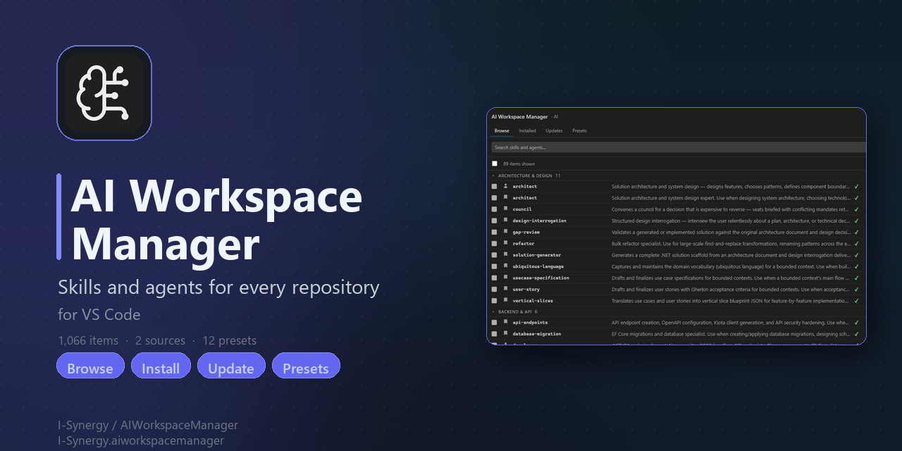
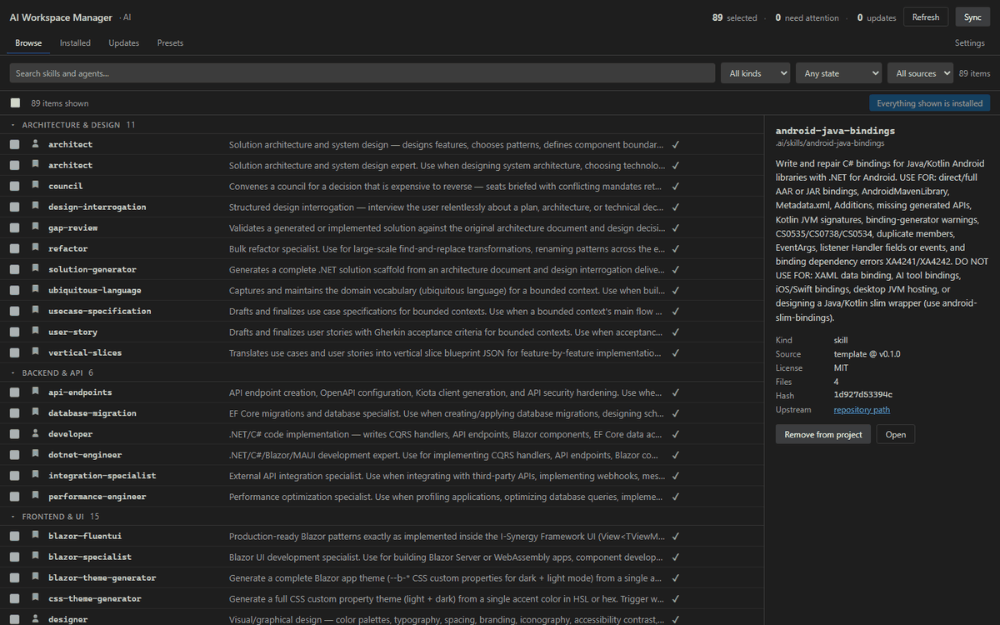

# .NET Development Template

[](https://github.com/I-Synergy/AI/releases/latest)
[](https://github.com/I-Synergy/AI/releases/latest)

[](https://sonarcloud.io/dashboard?id=I-Synergy_AI)
[](https://sonarcloud.io/dashboard?id=I-Synergy_AI)
[](https://sonarcloud.io/dashboard?id=I-Synergy_AI)
[](https://sonarcloud.io/dashboard?id=I-Synergy_AI)
[](https://sonarcloud.io/dashboard?id=I-Synergy_AI)
[](https://sonarcloud.io/dashboard?id=I-Synergy_AI)

Professional .NET development template with AI-powered agent orchestration and modular architecture.

## AI Workspace Manager (VS Code extension)

A template catalog can offer hundreds of skills and agents. Copying all of them into every project bloats the AI context, hides what is actually installed, and turns template updates into a blind overwrite.

[AI Workspace Manager](https://marketplace.visualstudio.com/items?itemName=I-Synergy.aiworkspacemanager) solves that. It is the VS Code front end for the template's per-repository resolver: you choose the skills and agents a repository needs — from a preset or item by item — and the extension records that selection, installs only those files, and shows what has drifted or changed upstream. Because it calls the same resolver CI uses, the UI cannot disagree with `sync --check`.





- **Browse** — search the whole catalog, filter by kind / source / state, and install a selection in bulk.
- **Installed** — see what this repo has, grouped by health, and remove or prune leftovers.
- **Updates** — compare installed items with upstream and update the safe ones.
- **Presets** — start from a named selection (Architecture, Security, .NET, MAUI, …) with resolved counts and deltas.
- **Settings** — choose the Python interpreter and manage sources, refs, and releases.
Components

- **Setup** — first activation writes the resolver, vocabulary, `AGENTS.md`, Copilot/Claude configuration, project folders, and the tool adapters.

Install it from the Extensions view (search **AI Workspace Manager for VS Code**) or:

```bash
code --install-extension I-Synergy.aiworkspacemanager
```

Open the project folder and use the AI Workspace Manager view. The extension keeps its local state in `.ai/ai.json`, `.ai/ai.lock.json`, `.ai/tooling.json`, `.ai/catalog/`, `.ai/installed/`, and the `*.ai-installed.json` markers. Those paths are **gitignored** here: they describe one machine's installed selection, not template content. The selected skills (including the former prompts), agents and instructions themselves live in `.ai/skills/`, `.ai/agents/` and `.ai/instructions/` and remain the committed source of truth.

## Overview

A **production-ready .NET project template** that provides comprehensive development patterns, specialized agent skills, and quality assurance tools for building enterprise applications with Clean Architecture, CQRS, and Domain-Driven Design.

AI context lives in `.ai/` (the single source of truth shared by Claude Code and GitHub Copilot). Each tool reads the same files through directory junctions — no duplication, no sync lag.

## Features

### Specialized Skills

Every skill in `.ai/skills/` is listed below. Each is a `SKILL.md` with YAML
frontmatter whose `description` decides when the model invokes it; the directory
name is the skill name (`/<skill-name>` invokes it explicitly).

#### Architecture & Design

| Skill | Purpose |
|-------|---------|
| **architect** | Architecture decisions, technology selection, bounded contexts |
| **product-discovery** | Plain-language product interview — capture what to build before designing architecture; produces product brief, wireframes, mockups, and clickable prototype |
| **design-interrogation** | Structured design interview — consumes product-discovery output; stress-test plans and interrogate technical dimensions (architecture, identity, data, delivery, operations, testing, AI); produces Product Specification |
| **ubiquitous-language** | Capture and maintain the domain glossary (`UBIQUITOUS_LANGUAGE.md`) |
| **usecase-specification** | Use case specs with `UC-`/`AF-` IDs and Gherkin |
| **user-story** | INVEST-validated user stories with `AC-`-identified criteria |
| **vertical-slices** | Translate use cases/stories into `AC-`-traced vertical slice blueprint JSON |
| **solution-generator** | Scaffold a .NET solution from an architecture document, tests traced to `AC-` IDs |
| **gap-review** | Validate a generated solution against the original design decisions |
| **council** | Expensive-to-reverse decisions — independent seat positions, chair synthesis, dissent recorded verbatim |

#### .NET Implementation

| Skill | Purpose |
|-------|---------|
| **dotnet-engineer** | CQRS handlers, endpoints, Blazor/MAUI code — all .NET implementation work |
| **api-endpoints** | Minimal API endpoints, OpenAPI, Kiota clients, validation and rate limiting |
| **database-migration** | EF Core migrations, schema design, query tuning, PostgreSQL |
| **integration-specialist** | Third-party APIs, webhooks, message queues, external service calls |
| **refactor** | Bulk find-and-replace and pattern migrations across the solution |
| **vscode-ts-to-csharp-migration** | Convert a TypeScript VS Code extension to a thin Node host plus a .NET sidecar — extension-host boundary, JSON-RPC transport, wave-based porting, VSIX packaging, cutover |

#### Security

| Skill | Purpose |
|-------|---------|
| **security** | Security strategy, compliance (GDPR/SOC2/HIPAA), threat modelling |
| **software-security** | Secure coding, OWASP Top 10, security code review |
| **api-security** | API authn/authz and OWASP API Top 10 |

#### Quality & Delivery

| Skill | Purpose |
|-------|---------|
| **code-reviewer** | SOLID/CQRS/architecture review with ISO/IEC 25010 finding attribution |
| **unit-tester** | MSTest + Moq unit tests, Reqnroll BDD scenarios, per-slice test plans |
| **playwright-tester** | Playwright E2E, accessibility and visual regression tests |
| **performance-engineer** | Profiling, query and caching optimisation, response times |
| **vscode-csharp-sidecar-benchmark** | Parity-checked latency and memory comparison of a VS Code extension's TypeScript path against its .NET sidecar — allocation, retention, process RSS |
| **devops-engineer** | CI/CD pipelines, containerisation, IaC, deployment automation |

#### UI Frameworks & Themes

| Skill | Purpose |
|-------|---------|
| **blazor-specialist** | Blazor Server/WebAssembly components, state management, forms |
| **blazor-fluentui** | I-Synergy patterns on Fluent UI Blazor (`View<TViewModel>`, bootstrapper, dialogs) |
| **winui-specialist** | WinUI 3 / Windows App SDK apps — Fluent layouts, MSIX packaging, WPF migration |
| **ui-core** | Cross-platform UI abstractions — auth, token storage, localisation, theme view models |
| **ui-blazor** | I-Synergy Blazor UI library — bootstrapper, Fluent integration, form factor, antiforgery |
| **ui-wpf** | I-Synergy WPF shell — dialogs, navigation, theme system, BladeView controls |
| **ui-winui** | I-Synergy WinUI 3 shell — Fluent shell, ContentDialog, title bar, accent sync |
| **ui-uwp** | I-Synergy UWP shell — Frame navigation, ContentDialog, adaptive layouts |
| **ui-maui** | I-Synergy MAUI shell — dialogs, navigation, theme, NavigationMenu controls |
| **blazor-theme-generator** | Blazor `--b-*` theme tokens for dark + light from one accent colour |
| **css-theme-generator** | CSS custom property theme (light + dark) from one accent colour |
| **xaml-theme-generator** | XAML ResourceDictionary themes (WinUI/UWP/MAUI) from one accent colour |
| **keycloak-theme-colors** | Recolour an I-Synergy Keycloak login theme from one base hex colour |

#### MAUI

| Skill | Purpose |
|-------|---------|
| **maui-specialist** | Cross-platform MAUI apps, offline-first data, platform features |
| **maui-blazor** | I-Synergy MVVM patterns for MAUI + Blazor Hybrid shells |
| **maui-apple-design** | Apple-style fluid motion — springs, gestures, momentum, materials, type scale, reduced motion, haptics |
| **mobile-release** | App Store / Google Play artifacts, signing, uploads, store rejections |

#### MAUI Labs (third-party source)

The MAUI Labs skills are not copied into this template. They come from
[`dotnet/maui-labs`](https://github.com/dotnet/maui-labs) through the built-in
`dotnet-maui` and `dotnet-maui-tooling` sources, pinned to a ref in `.ai/ai.json`,
and are installed only in projects that select them (the `.NET MAUI` preset
includes them). The source id is the plugin name, so provenance stays visible in
the selection:

| Source id | Skills |
|---|---|
| `dotnet-maui` | `maui-accessibility`, `maui-ai-tool-bindings`, `maui-app-architecture`, `maui-app-assets-lifecycle`, `maui-aspire-client`, `maui-auth-secure-storage`, `maui-blazor-hybrid`, `maui-controls-deep-dive`, `maui-current-apis`, `maui-custom-handlers`, `maui-device-capabilities`, `maui-essentials-ai`, `maui-labs-platform-targeting`, `maui-localization-theming`, `maui-networking-offline-data`, `maui-notifications-deep-links`, `maui-performance`, `maui-platform-invoke`, `maui-project-structure`, `maui-release-notes`, `maui-ui-patterns`, `maui-unit-testing`, `maui-xcode27-migration`, `xamarin-forms-migration` |
| `dotnet-maui-tooling` | `android-java-bindings`, `android-slim-bindings`, `devflow-automation`, `devflow-connect`, `dotnet-workload-info`, `ios-slim-bindings`, `maui-ai-debugging`, `maui-devflow-debug`, `maui-devflow-onboard`, `maui-devflow-session-review` |

The repository's agents (`agentic-workflows`, `comet-squad`, `expert-reviewer`)
and instructions (`dependencies`, `devflow-architecture`, `mcp-tools`,
`packaging`, `testing`) are available in Browse under `dotnet-maui`.

#### Aspire (third-party source)

The official Aspire skills are not copied either. They come from
[`microsoft/aspire-skills`](https://github.com/microsoft/aspire-skills) through
the built-in `aspire-skills` source, and the `Aspire` preset selects all seven:
`aspire` (router), `aspire-init`, `aspireify`, `aspire-orchestration`,
`aspire-monitoring`, `aspire-deployment` and `aspire-project-v2-migration`.

#### Documentation & Content

| Skill | Purpose |
|-------|---------|
| **technical-writer** | XML docs, API docs, architecture diagrams, READMEs |
| **hugo** | Hugo + Tailwind v4 sites, headless CMS, Cloudflare deployment |
| **book-to-skill** | Turn a PDF/EPUB book into a reusable skill |

#### Template Tooling

| Skill | Purpose |
|-------|---------|
| **skill-creator** | Create, test and tune skills, including description triggering |
| **sync-platforms** | Link `.ai/` into the paths each tool reads (Claude Code, GitHub Copilot, other skills-standard agents), and generate `.claude/rules/` from `.ai/instructions/`; `--tools` limits the set |
| **upgrade-template** | Sync template improvements to existing projects without losing context |
| **verify-config** | Audit config drift and generate the standards-compatibility view |

#### Explicit-Only Skills (19, formerly prompts)

These 19 skills were prompt files (`.ai/prompts/*.prompt.md`) until this release. The
Copilot harness does not load prompt files, so each one is now a skill with
`disable-model-invocation: true`: an agent never picks it up on its own. Invoke it by
name, for example `/ef-core`. Claude Code and Copilot both load them through
`.claude/skills/` and `.github/skills/`.

| Skill | Purpose |
|--------|---------|
| **architectural-code-review-modernize** | Solution-wide C#/TypeScript/LINQ/SQL review with compilable replacements |
| **architecture-blueprint-generator** | Architecture blueprint, diagrams and implementation patterns from the codebase |
| **aspnet-minimal-api-openapi** | ASP.NET Minimal API endpoints with OpenAPI documentation |
| **create-implementation-plan** | Implementation plan for features, refactors and upgrades |
| **create-readme** | Project README from the codebase |
| **create-unittest** | MSTest unit-test patterns, including data-driven tests |
| **csharp-async** | C# async programming best practices |
| **csharp-docs** | XML documentation for C# types |
| **documentation-writer** | Diátaxis technical documentation |
| **dotnet-best-practices** | .NET/C# solution best practices |
| **dotnet-design-pattern-review** | Design-pattern review for C#/.NET code |
| **ef-core** | Entity Framework Core best practices |
| **folder-structure-blueprint-generator** | Folder-structure blueprint, conventions and placement patterns |
| **generate-custom-instructions-from-codebase** | Instructions from a migration, refactor or version-upgrade diff |
| **iso-5055-quality-enforcer** | ISO/IEC 5055 risk report and refactor fixes |
| **postgresql-optimization** | PostgreSQL-specific features, types and query optimisation |
| **prompt-builder** | Build high-quality Copilot prompts with the right structure and tools |
| **update-markdown-file-index** | Markdown index/table for the files in a folder |
| **usecases-gherkin-specs** | Use cases and Gherkin BDD specifications for Clean Architecture |

### Instructions (4)

Every file in `.ai/instructions/` is a `*.instructions.md` with an `applyTo` glob. The
files reach the tools in two ways:

- **GitHub Copilot:** read directly from `.github/instructions/` (a folder link to `.ai/instructions/`).
- **Claude Code:** `sync-platforms.py` copies each file to `.claude/rules/{name}.instructions.md`, mapping `applyTo` to the `paths:` frontmatter (`**/*` gets no `paths:`, so it always applies). The copies are generated, gitignored and never edited by hand. Hand-written rules in `.claude/rules/` are never touched.

Edit the source in `.ai/instructions/`, then run `python .ai/scripts/sync-platforms.py`.

| Instruction | `applyTo` | Purpose |
|-------------|-----------|---------|
| **csharp** | `**/*.cs` | C# rules: the critical rules in short form, with links to patterns, forbidden tech and templates |
| **tests** | `tests/**` | Test project rules: MSTest only, test structure, traceability IDs |
| **ai-workspace** | `.ai/progress/**`, `.ai/plans/**`, `.ai/completed/**`, `.ai/session-context.md` | Progress, plan and handoff conventions |
| **sonarqube_mcp** | `**/*` | Guidelines for using the SonarQube MCP tools during a task |

### Pattern Guides (8)

| Pattern | Description |
|---------|-------------|
| **cqrs-patterns** | Complete Command/Query separation guide |
| **api-patterns** | RESTful API and Minimal API patterns |
| **testing-patterns** | Unit, integration, and BDD testing with acceptance-criterion tags |
| **mvvm** | Model-View-ViewModel for UI |
| **microservices** | Microservices architecture patterns |
| **service-oriented-architecture** | SOA patterns and practices |
| **object-oriented-programming** | OOP principles and patterns |
| **test-driven-development** | TDD workflow and best practices |

### Template Tokens

| Token | Meaning | Example Usage |
|-------|---------|---------------|
| `{ApplicationName}` | Your application name | `{ApplicationName}.Domains` |
| `{Domain}` | Bounded context (a `Features/` folder, not a project) | `Domains/Features/{Entities}/` |
| `{Entity}` | Aggregate root (PascalCase) | `Create{Entity}Command` |
| `{Entities}` | Aggregate root plural (PascalCase) — used for DbSet names | `dataContext.{Entities}` |
| `{entity}` | Aggregate root (camelCase) | `{entity}Id` |
| `{entities}` | Aggregate root plural (camelCase) | `/{entities}` |
| `{ChildEntity}` | Child entity (PascalCase) | `{Entity}With{ChildEntities}Response` |
| `{ChildEntities}` | Child entity plural (PascalCase) | `dataContext.{ChildEntities}` |
| `{childEntity}` | Child entity (camelCase) | `{childEntity}Id` |
| `{childEntities}` | Child entity plural (camelCase) | `/{childEntities}` |

The template ships no concrete business domain; every example is expressed with these tokens.

See `.ai/reference/tokens.md` for complete definitions.

### Solution Scaffold

`.ai/reference/templates/solution/` holds the templates, and `.ai/scripts/scaffold-solution.py` renders them into a new .NET solution. The generated solution:

- uses a flat layout: one project per layer (`Common`, `Entities`, `Models`, `Data`, `Data.SqlServer` or `Data.Postgres`, `Domains`, `Services`, `Service.Api`, `Clients`), with optional heads;
- manages package versions centrally (`Directory.Packages.props`), treats NuGet audit findings as errors, and sets `LangVersion` 15.0 on the .NET 11 SDK;
- offers optional projects: an Aspire AppHost (`apphost`), a MAUI head for Windows, Android and Apple (`maui`), a plain-Razor web head (`web`) and a SQLite device store (`sqlite-device`);
- regenerates its Kiota client from the API's OpenAPI document on every Debug build of `Service.Api`;
- ships one sample entity (`Item` by default) with handlers, endpoints, client code and tests, so it builds before you write any code.

Flags, the generated layout, prerequisites and what you still create yourself are in the "Scaffold the Solution (Optional)" section of [TEMPLATE-USAGE.md](TEMPLATE-USAGE.md).

## Quick Start

### 1. Install a Selection (Recommended: AI Workspace Manager)

Do not copy the whole catalog. Install only the skills, agents and instructions the project needs:

1. Install **AI Workspace Manager** from the Extensions view, or run `code --install-extension I-Synergy.aiworkspacemanager`.
2. Open the project folder and pick a preset (Architecture, Security, .NET, MAUI, …), or choose items individually.
3. Let the extension install the selection. On first activation it also writes the resolver, `AGENTS.md`, the Copilot/Claude configuration, the project folders and the tool adapters. Existing `.vscode/settings.json`, `.vscode/tasks.json` and `.claude/settings.json` files are merged, never overwritten (see [Shared Settings Merge](#shared-settings-merge)).

The selection, its pinned revisions and its content hashes are recorded locally, so installing, removing and updating items is reviewable instead of a blind overwrite. See [AI Workspace Manager](#ai-workspace-manager-vs-code-extension) above for the full workflow.

#### Manual fallback — copy the template

Use this path only when the extension cannot be used (air-gapped machine, no VS Code, or you deliberately want the full library). It copies **every** skill, agent and instruction into the project.

```bash
# Copy AI context to your project root
cp -r ./.ai /path/to/YourProject/.ai

# Copy root config file
cp ./AGENTS.md /path/to/YourProject/

# Copy tool configs (minimal — junctions do the rest)
mkdir -p /path/to/YourProject/.claude /path/to/YourProject/.github
cp -r ./.claude/settings.json /path/to/YourProject/.claude/
cp -r ./.github/copilot-instructions.md /path/to/YourProject/.github/
```

### 2. Know What Is Always Copied

The resolver selects **skills, agents and instructions**. The directories below are outside the selection on purpose — `AGENTS.md`, the agents and the skills cite them by literal path, so they must exist in every project:

| Path | Why it is always present |
|------|--------------------------|
| `.ai/reference/` | `critical-rules.md`, `tokens.md`, `council.md`, … are cited by path |
| `.ai/patterns/` | CQRS, API, testing, MVVM and other patterns are cited by path |
| `.ai/checklists/` | Pre-submission gate used by the agent workflow |
| `.ai/project/`, `.ai/session-context.md` | Project-owned context and session memory |
| `.ai/scripts/`, `.ai/tests/` | Junction sync, upgrade and the validation suites |

Selection reduces the catalog; it does not remove this floor.

### 3. Create or Repair the Adapters

Tools only read their own hardcoded paths, so `.ai/` is exposed through per-tool links — no file copies.

```bash
cd /path/to/YourProject
python .ai/scripts/sync-platforms.py
```

This creates six folder links:

| Junction | → Source | Used By |
|----------|----------|---------|
| `.claude/skills` | `.ai/skills` | Claude Code |
| `.claude/agents` | `.ai/agents` | Claude Code |
| `.github/skills` | `.ai/skills` | GitHub Copilot |
| `.github/agents` | `.ai/agents` | GitHub Copilot |
| `.github/instructions` | `.ai/instructions` | GitHub Copilot |
| `.agents/skills` | `.ai/skills` | Other skills-standard agents (Codex, …) |

It also generates (copies, not links) the Claude Code path-scoped rules, `.claude/rules/{name}.instructions.md`, one per file in `.ai/instructions/`. They are gitignored and regenerated on every run.

The prompt adapters are conditional. The template ships no `.ai/prompts/` (prompts are skills now), so a fresh project gets no `.claude/commands` or `.github/prompts`. A project that installed prompts from a catalog (for example awesome-copilot, through the extension) has them linked: `.claude/commands` and `.github/prompts` point at `.ai/prompts` only while that folder holds at least one file. When it is absent or empty, both links are retired.

`.claude/instructions` is retired for good (Claude Code never read it). The script removes the retired adapters when they are links or empty directories. Real content found at a retired path is reported as `CONFLICT` and left in place.

All adapter targets are in `.gitignore` — zero git bloat, and no second copy of any
skill. Adapters are local, not committed. They are created on Claude Code session start,
by the `SessionStart` hook; after an upgrade; or by running this command. VS Code has a
task, **Link .ai into the paths tools read** (`.vscode/tasks.json`), that runs the same
script on demand. It does not run on folder open.

### 4. Check for Drift

After installing or updating a selection, confirm the repository matches the recorded selection. AI Workspace Manager shows this on its **Installed** view; the same check is available as the resolver's `sync --check`, which is what CI compares against. Treat any drift as a review step — a blind re-copy is exactly what overwrites project changes.

### Shared Settings Merge

Setup by AI Workspace Manager and `upgrade-template.py` never overwrite a project's VS Code or Claude settings. They merge the template's shipped configuration into the project's files:

| Project file | Template source | Result |
|---|---|---|
| `.vscode/settings.json` | `.ai/reference/templates/vscode/settings.json` | Created when missing, otherwise merged |
| `.vscode/tasks.json` | `.ai/reference/templates/vscode/tasks.json` | Created when missing, otherwise merged |
| `.claude/settings.json` | `.claude/settings.json` | Created when missing, otherwise merged |

The rules are the same for both tools. The shared data lives in `.ai/reference/templates/merge-rules.json`:

- **Missing key:** added.
- **Object on both sides** (for example `terminal.integrated.env.windows`): merged key by key, so a project's `PIP_CONFIG_FILE` stays and the MSBuild variables are added.
- **Pinned Copilot key** (`vscode.pinnedSettings`): the template value replaces the project's. The project's comment on that line is kept, so the comment can describe an old value.
- **Any other conflicting scalar or array:** the project's value is kept and reported as a conflict.
- **`tasks.json`:** tasks merge by `label`. A missing label is appended; an existing label is kept unchanged. `version` is added only when absent.
- **`.claude/settings.json`:** the legacy hook commands listed in `claude.legacyHookCommands` are removed, and template hook groups are added unless their command is already present. Every other project hook is kept. `permissions.allow`, `permissions.deny` and `permissions.additionalDirectories` are unioned, keeping the project's order. Other top-level keys (such as `plansDirectory`) are added when missing; the project's value wins on a conflict.
- **Formatting and comments** are preserved. The merge edits the text and does not re-serialise the file.
- **Invalid JSON** in the project file (including duplicate keys, which VS Code tolerates but the merge does not) makes the merge write nothing and report the error.
- **Idempotent:** a second run changes nothing.

The template's own `.vscode/settings.json` also holds settings for working on the template (`python.testing.*`, `python.envFile`, and `PIP_CONFIG_FILE`). Those are never shipped. Projects receive only the fragment files above. If a template ref has no fragments (an older ref), the `.vscode` merge is skipped; the template's own `.vscode` files are never copied.

### 5. Per-Tool Setup

`AGENTS.md` at the project root holds the orchestration instructions. Claude Code loads it directly. Skills and agents are discovered through tool-scoped adapters (`.claude/`, `.github/`, `.agents/`).

#### Claude Code

```bash
claude  # start in project root
```

Claude Code reads `.claude/settings.json`, which wires three hooks:

| Hook | Runs | What it does |
|------|------|--------------|
| `SessionStart` | Every session start, resume, clear or compact | Runs `sync-platforms.py`, then prints `.ai/session-context.md` (skipped while it is the unfilled placeholder) |
| `PostToolUse` | An edit under `.ai/skills/`, `.ai/agents/` or `.ai/instructions/` | Re-runs `sync-platforms.py` so the adapters and `.claude/rules/` pick up the change |
| `Stop` | End of a turn | Builds the solution, only when `src/` or `tests/` changed since the last good build (Claude Code only) |

The hook logic lives in `.ai/scripts/hooks/` and runs through `py.sh`, which uses `python3` when it works and `python` otherwise. The scripts are shared with Copilot, but are wired only in `.claude/settings.json`. The hooks are an enhancement, not a control. Whether the Copilot harness also runs them is checked by a probe: `.ai/tmp/hook-probe.log` records which harness fired the `SessionStart` hook.

#### GitHub Copilot

VS Code gets its project instructions from `.github/copilot-instructions.md`. That file is generated from `AGENTS.md`: a verbatim copy, followed by a Copilot runtime section (from `.ai/reference/copilot-runtime.md`) that explains session start, delegation, rules and session end, and a project-owned block that the regeneration keeps. After editing `AGENTS.md`, run `python .ai/scripts/sync-instructions.py`. `validate-copilot.py` fails if the generated file drifts from `AGENTS.md`.

The template's `.vscode/settings.json` is tracked and sets the workspace-level Copilot behaviour. Projects get these keys by merge, not by copy (see [Shared Settings Merge](#shared-settings-merge)):

| Setting | Value | Why | Harness |
|---|---|---|---|
| `chat.useAgentsMdFile` | `false` | Stops VS Code loading `AGENTS.md` a second time, because `copilot-instructions.md` embeds it | Local harness only. It does not control Copilot instruction discovery, so the Copilot harness may still load both files |
| `github.copilot.chat.cli.customAgents.enabled` | `true` | Enables custom agents (`.ai/agents/`) in Copilot harness sessions | Copilot harness |
| `chat.useClaudeHooks` | `true` | Runs the hooks in `.claude/settings.json` in the Local harness (trusted workspace only) | Local harness |
| `chat.defaultConfiguration` | `{ "approvals": "manual" }` | New sessions start with manual tool approval. Assisted Permissions sends an extra safety-judge request to the session model on every tool call, which a bring-your-own-key model bills to its own key. Not pinned: a project can set another value, and the permission picker can still change a single session | Local harness and agent host |
| `chat.useAgentSkills`, `chat.includeApplyingInstructions`, `github.copilot.chat.codeGeneration.useInstructionFiles` | `true` | Load skills and path-scoped instructions; the workspace pins them so a user setting cannot turn them off | Local harness |

`.vscode/settings.json` also mirrors the `env` block of `.claude/settings.json` into `terminal.integrated.env.*`, so VS Code terminals get the same environment as Claude Code. The session-end build check is a hook for Claude Code (`Stop`) and an instruction for Copilot, which has no `Stop` hook (`.ai/reference/copilot-runtime.md`, section 4).

Copilot CLI and the cloud agent do not read the Local-harness settings. Some settings can only be set per user, so they are not in the workspace: Copilot sign-in and model choice (bring-your-own-key credentials are account-level), and tool auto-approval, which the template deliberately leaves unset.

**Run sessions in the orchestrator agent.** Select **orchestrator** in the VS Code agent dropdown. It always has the delegation tool and may run every specialist agent the project has, so you do not need to enable **Run Subagent** for them. Enable Run Subagent (Agent mode → Configure Tools) only when you run a different agent. `orchestrator` is the Copilot entry point, not a delegation target: specialist agents and Claude Code do not delegate to it. It carries no `agents:` list, so agents you install in `.ai/agents/` are available to it without editing a template-owned file. If Copilot ignores the rules or the agents, see the section "Troubleshooting: Copilot ignores the rules or agents" in `.ai/reference/copilot-integration.md`.

Neither file is listed in VS Code's Customizations editor, because that editor lists customization items (skills, agents, `*.instructions.md`) rather than project instruction files — "not listed" does not mean ignored.

### 6. Scaffold the Solution (Optional)

```bash
python .ai/scripts/scaffold-solution.py
```

The script prompts for the application name, company, first sample entity, database provider and optional heads, then renders a .NET 11 solution into `./<Name>`. Existing files are never overwritten; `--dry-run` lists the files without writing them. Flags, the generated layout and the steps you still take (for example `dotnet ef migrations add Initial`) are in the "Scaffold the Solution (Optional)" section of [TEMPLATE-USAGE.md](TEMPLATE-USAGE.md).

### 7. Verify

```bash
bash .ai/tests/run-all-tests.sh
```

Every suite should pass.

### Customize Project Files

Edit files in `.ai/project/` to customize for your project:

| File | Purpose | Key Question |
|------|---------|--------------|
| **preferences.md** | Personal workflow & style | **HOW** do you prefer to work? |
| **tech-stack.md** | Technology choices & versions | **WHAT** technologies do you use? |
| **architecture.md** | System design & patterns | **HOW** is your system structured? |
| **domains.md** | Business context & entities | **WHAT** are you building? |

### Replace Tokens

```bash
# Replace each token with your own value, longest/most-specific first
find /path/to/YourProject/.ai -type f -exec sed -i 's/{ApplicationName}/YourApplication/g' {} +
find /path/to/YourProject/.ai -type f -exec sed -i 's/{ChildEntities}/YourChildEntities/g' {} +
find /path/to/YourProject/.ai -type f -exec sed -i 's/{ChildEntity}/YourChildEntity/g' {} +
find /path/to/YourProject/.ai -type f -exec sed -i 's/{childEntities}/yourChildEntities/g' {} +
find /path/to/YourProject/.ai -type f -exec sed -i 's/{childEntity}/yourChildEntity/g' {} +
find /path/to/YourProject/.ai -type f -exec sed -i 's/{Domain}/YourDomain/g' {} +
find /path/to/YourProject/.ai -type f -exec sed -i 's/{Entities}/YourEntities/g' {} +
find /path/to/YourProject/.ai -type f -exec sed -i 's/{Entity}/YourEntity/g' {} +
find /path/to/YourProject/.ai -type f -exec sed -i 's/{entities}/yourEntities/g' {} +
find /path/to/YourProject/.ai -type f -exec sed -i 's/{entity}/yourEntity/g' {} +
```

### Initialize Session Context

Edit `.ai/session-context.md` to establish your project's initial state.

### Session Memory Across Clients

`.ai/session-context.md` is the shared memory for every client. Both tools (Claude Code and GitHub Copilot) read and write the same file to preserve context across sessions.

| Client | Read Mechanism | Write Mechanism |
|--------|---|---|
| **Claude Code** | `SessionStart` hook prints the file (first 200 lines, skipped while placeholder) + instruction in AGENTS.md | Instruction in AGENTS.md: write handoff before final reply using `.ai/reference/templates/session-handoff.md.txt` |
| **GitHub Copilot** | Copilot runtime section in `.github/copilot-instructions.md` tells the model to read the file first. The shared `SessionStart` hook may also fire in the Copilot harness; `.ai/tmp/hook-probe.log` shows whether it does | Copilot runtime section in `.github/copilot-instructions.md`: write handoff before final reply |

`.ai/session-context.md` ships as an unfilled placeholder — fill it in for your project and keep it updated. `.ai/plans/`, `.ai/progress/`, and `.ai/completed/` ship empty; they are populated only while work is in flight.

### Start Developing

```
/api-endpoints "Create CRUD endpoints for {Entity} entity"
```

## File Structure

```
/
├── AGENTS.md                        # AI orchestration (Claude Code loads it; VS Code gets it via copilot-instructions.md)
├── TEMPLATE-USAGE.md                # Detailed usage guide
├── TEMPLATE-FAQ.md                  # Frequently asked questions
├── README.md                        # This file
├── CHANGELOG.md                     # Manually curated changelog (not updated by CI)
├── LICENSE                          # MIT license
├── pytest.ini                       # Pytest configuration (testpaths = .ai/tests)
├── pip.ini                          # Project-scoped pip config
├── requirements-dev.txt             # Development dependency pins (PyYAML, pytest)
├── requirements-dev.lock            # Hash-pinned dependency lock installed by CI
├── .sonarcloud.properties           # Analysis scope + UTF-8 encoding for SonarCloud
├── .gitattributes                   # LF line endings enforced for *.sh
├── .gitignore                       # Excludes junction targets + pycache
├── .vscode/
│   ├── settings.json                # Template's own dev settings (pytest, PIP_CONFIG_FILE) plus the Copilot keys projects receive by merge ("GitHub Copilot" under Per-Tool Setup)
│   └── tasks.json                   # "Link .ai into the paths tools read" — run on demand, no folder-open run; projects receive it by merge
├── .claude/
│   ├── settings.json                # Claude Code config (SessionStart, PostToolUse, Stop hooks; permissions)
│   ├── skills/  → .ai/skills/       # Junction — do not edit
│   ├── agents/  → .ai/agents/       # Junction — do not edit
│   └── rules/                       # Generated copies of .ai/instructions/ (gitignored); hand-written rules here are kept
├── .github/
│   ├── copilot-instructions.md      # GitHub Copilot instructions — generated from AGENTS.md + copilot-runtime.md
│   ├── workflows/
│   │   ├── validate-template.yml    # Runs the validation suite in CI
│   │   └── ci.yml                   # Versions, tags and publishes a release on merge to main
│   ├── skills/  → .ai/skills/       # Junction — do not edit
│   ├── agents/  → .ai/agents/       # Junction — do not edit
│   └── instructions/  → .ai/instructions/  # Junction — do not edit
├── .agents/
│   └── skills/  → .ai/skills/       # Junction — read by other skills-standard agents
└── .ai/                             # All AI context (vendor-neutral, shared by all assistants)
    ├── session-context.md           # Working session memory
    ├── reference/
    │   ├── critical-rules.md        # Non-negotiable patterns (read first)
    │   ├── forbidden-tech.md        # Technologies to avoid
    │   ├── tokens.md                # Token definitions
    │   ├── glossary.md              # Terminology
    │   ├── naming-conventions.md
    │   ├── copilot-integration.md   # Copilot adapters, sync and troubleshooting
    │   ├── copilot-runtime.md       # Copilot session/delegation/rules protocol (emitted into copilot-instructions.md)
    │   ├── task-execution.md        # ReAct loop, escalation, subagent templates
    │   ├── work-type-mapping.md     # Which files to load per task type
    │   ├── operational-rules.md     # Refactoring and file-management conventions
    │   ├── session-management.md    # Session lifecycle
    │   ├── aot-and-trimming.md      # Native AOT and trimming lessons
    │   ├── readme-maintenance.md    # README update requirements
    │   ├── council.md               # Council principle — high-stakes decisions
    │   ├── traceability.md          # Story → criterion → scenario → test identifiers
    │   ├── quality-model.md         # ISO/IEC 25010 review vocabulary and severity
    │   ├── test-documentation.md    # ISO/IEC/IEEE 29119-3 test documents — adopted and omitted
    │   ├── standards.md             # Standards-compatibility manifest (read by verify-config)
    │   └── templates/               # Code and document templates (.cs.txt, .feature.txt, .md.txt)
    │       ├── command-handler.cs.txt
    │       ├── query-handler.cs.txt
    │       ├── endpoint.cs.txt
    │       ├── test-class.cs.txt
    │       ├── feature-file.feature.txt
    │       ├── session-handoff.md.txt
    │       ├── test-plan.md.txt
    │       ├── test-completion-report.md.txt
    │       ├── test-incident-report.md.txt
    │       ├── compliance.md.txt
    │       ├── standards-section.md.txt
    │       ├── merge-rules.json     # Shared merge data: pinned Copilot keys, legacy Claude hook commands
    │       ├── solution/            # Solution scaffold templates (files/, manifest.json, package-versions.json); contract in solution/README.md
    │       └── vscode/              # Fragments merged into a project's .vscode/settings.json and tasks.json
    │           ├── settings.json
    │           └── tasks.json
    ├── patterns/                    # Implementation guides
    │   ├── cqrs-patterns.md
    │   ├── api-patterns.md
    │   ├── testing-patterns.md
    │   ├── mvvm.md
    │   ├── microservices.md
    │   ├── service-oriented-architecture.md
    │   ├── object-oriented-programming.md
    │   └── test-driven-development.md
    ├── instructions/                # Path-scoped rules, *.instructions.md (source of truth; applyTo glob)
    │   ├── csharp.instructions.md          # **/*.cs
    │   ├── tests.instructions.md           # tests/**
    │   ├── ai-workspace.instructions.md    # progress, plans, completed, session-context
    │   └── sonarqube_mcp.instructions.md   # **/*
    ├── scripts/                     # Automation scripts
    │   ├── sync-platforms.py        # Link .ai/ into the paths tools read, generate .claude/rules (--tools to limit)
    │   ├── sync-instructions.py     # Regenerate .github/copilot-instructions.md from AGENTS.md
    │   ├── hooks/                   # Shared hook logic: session_start.py, post_edit_sync.py, stop_build.py, _common.py, py.sh launcher
    │   ├── sync-agents.py           # Agent-side entry point (delegates to sync-platforms.py)
    │   ├── hygiene-lint.py          # Read-only hygiene lint — stale progress, committed secrets
    │   ├── migrate-to-ai.py         # Migrate a repo from the old .claude/ layout to .ai/
    │   ├── jsonc_merge.py           # Comment-preserving JSON(C) edits used by upgrade-template.py (stdlib only)
    │   ├── scaffold-solution.py     # Render a .NET solution from reference/templates/solution (prompts or flags; --dry-run, --check-templates)
    │   └── upgrade-template.py      # Safely upgrade an existing project from this template; merges .vscode/ and .claude/settings.json
    ├── agents/                      # Specialized subagents (source of truth)
    ├── skills/                      # Specialized agent personas (source of truth)
    │   ├── <skill>/SKILL.md         # One directory per skill — all listed under "Specialized Skills"
    │   ├── product-discovery/
    │   │   ├── SKILL.md
    │   │   ├── references/          # question-bank.md, output-templates.md, prototype-guide.md
    │   │   └── assets/prototype-scaffold/  # HTML/CSS/JS clickable prototype scaffold
    │   └── design-interrogation/
    │       ├── SKILL.md             # Extended to consume product-discovery output
    │       └── references/product-specification-template.md
    ├── checklists/
    │   └── pre-submission.md        # Quality gate — run before completing any task
    ├── project/                     # CUSTOMIZE THESE FOR YOUR PROJECT
    │   ├── preferences.md           # HOW you work (workflow, style, autonomy)
    │   ├── tech-stack.md            # WHAT you use (tech choices, versions)
    │   ├── architecture.md          # HOW it's structured (layers, patterns, flow)
    │   ├── domains.md               # WHAT you're building (business, entities)
    │   └── README.md
    ├── plans/                       # Plan files (written by Claude Code)
    ├── progress/                    # Active task tracking
    ├── completed/                   # Archived completed tasks
    ├── analysis/                    # Analysis files
    ├── tmp/                         # Scratch files and hook-probe.log (gitignored)
    └── tests/                       # Template validation suite
        ├── run-all-tests.sh         # Run every suite via bash
        ├── conftest.py              # Pytest shared fixtures
        ├── test_suite.py            # Pytest wrappers for VS Code Test Explorer
        ├── validate-structure.sh
        ├── validate-skills.py
        ├── validate-references.sh
        ├── validate-content.py
        ├── validate-tokens.sh
        ├── validate-agents-md.py
        ├── validate-settings.py
        ├── validate-triggers.py
        ├── validate-prose.py
        ├── validate-copilot.py
        ├── smoke-test.py
        ├── validate-traceability.py
        ├── validate-standards.py
        ├── validate-adapters.py     # Copilot-parity adapter layout (suite 15)
        ├── validate-scaffold.py     # solution scaffold: render matrix, template rules, forbidden terms (suite 16)
        ├── test_hooks.py            # pytest unit tests for scripts/hooks/ and the rules generator
        ├── test_jsonc_merge.py      # pytest unit tests for the JSONC merge and the .vscode / .claude/settings.json merges
        ├── test_sync_platforms.py   # pytest unit tests for the prompt-adapter rules in sync-platforms.py
        └── validate-upgrade-script.py
```

### Skills Architecture — One Source, Per-Tool Adapters

No agent reads `.ai/` directly: every tool hardcodes the project paths it scans. VS Code
(Copilot) enumerates `.agents/skills`, `.github/skills` and `.claude/skills`; Claude Code
reads `.claude/skills`; OpenAI Codex reads `.agents/skills`. There is no setting that adds
`.ai/skills` to those lists.

So the template keeps **one copy** of every file in `.ai/` and exposes it through links:

```
.ai/skills/              ← the only copy — edit here (prompts are skills too)
.ai/agents/              ← agent definitions with runAs: subagent
.ai/instructions/        ← path-scoped rules (*.instructions.md)

.claude/skills/          → link → .ai/skills/
.claude/agents/          → link → .ai/agents/
.claude/rules/*.instructions.md   ← generated copies of .ai/instructions/ (paths: frontmatter)
.github/skills/          → link → .ai/skills/
.github/agents/          → link → .ai/agents/
.github/instructions/    → link → .ai/instructions/
.agents/skills/          → link → .ai/skills/
```

Nothing is copied into the adapter folders, so editing `.ai/` changes every tool at once.
The one exception is `.claude/rules/`: Claude Code reads path-scoped rules only from that
folder, not from a link, so `sync-platforms.py` writes regular copies there. Those copies
are gitignored and carry a generated-from marker. Do not edit them.

VS Code labels each source separately in the Customizations editor, which is why the same
skill can be listed twice — once per adapter path. Each tool still resolves only its own
paths, so the model receives the skill once.

Git cannot track junctions (or symlinks, with the common `core.symlinks=false` default),
so a fresh clone has **none** of these six folder links. Four mechanisms create them:

| Trigger | Covers |
|---|---|
| `SessionStart` hook in `.claude/settings.json` | Claude Code session start (runs the sync before the session context is printed) |
| `PostToolUse` hook in `.claude/settings.json` | Claude Code edits under `.ai/skills/`, `.ai/agents/`, `.ai/instructions/` |
| `Link .ai into the paths tools read` in `.vscode/tasks.json` | VS Code, on demand (Terminal → Run Task). No automatic run on folder open |
| `python .ai/scripts/sync-platforms.py` | CLI tools, CI, Copilot when an adapter path is missing, and anything else |

The task is run on demand, not on folder open. A repository that runs a script as soon as it
is opened is an auto-execution surface, and the architecture council decided against adding one.
If you prefer automatic linking, VS Code also needs `task.allowAutomaticTasks` allowed once
per user; the template does not set it.

```bash
python .ai/scripts/sync-platforms.py                  # every supported tool
python .ai/scripts/sync-platforms.py --tools claude    # only the paths you use
```

The script is idempotent, repairs broken links, and removes junctions left behind by
unsupported platforms. If a real directory holding files appears at an adapter path it
reports `CONFLICT` instead of deleting it — a copy of the canonical content is the one
thing this layout does not allow.

`sync-skills.py` remains as a deprecated alias for hooks created before the
rename; new instructions should call `sync-platforms.py`.

### Specialized Agents

All code and design work is delegated to specialized subagents — the main conversation handles only reasoning and user interaction.

| Agent | Role |
|-------|------|
| `orchestrator` | GitHub Copilot entry point. Select it in the VS Code agent dropdown; it runs every specialist agent the project has, including agents you install. Not a delegation target |
| `architect` | Feature design, pattern selection, component boundaries, architecture analysis |
| `reviewer` | Code quality, SOLID, CQRS compliance, security review, architecture audit, ISO/IEC 25010 finding attribution |
| `security` | Blast-radius and exposure analysis, threat modelling, OWASP review, dependency and secret audits |
| `tester` | MSTest/Reqnroll test design, BDD scenarios, integration test strategy |
| `designer` | Visual design — color palettes, typography, branding, design tokens |
| `developer` | .NET/C# — CQRS handlers, API endpoints, Blazor, EF Core, refactoring |
| `ui-developer` | Blazor/MAUI components, layouts, CSS/styling, UX patterns |
| `ui-tester` | Playwright E2E tests, accessibility checks, visual regression |
| `writer` | XML docs, READMEs, ADRs, technical prose |

Each agent's `model:` frontmatter in `.ai/agents/` carries the tier alias (`sonnet` or `haiku`); the concrete model bound to that tier is chosen by the backend runtime outside this repository.

Agents are defined in `.ai/agents/`. The nine specialist agents carry `runAs: subagent`; `orchestrator` does not, because it is the Copilot entry point and not a delegation target. `orchestrator` also carries no `agents:` list: the inventory belongs to the project, so an agent installed from another source is available to it, and an upgrade never writes the template's list back over yours. Every tool reads them through a folder-level junction (`.claude/agents/`, `.github/agents/`). Each agent body starts with a "Before starting, read:" list of the skills and rules it needs. Copilot ignores the Claude-only `skills:` frontmatter, so that list is what carries the rules into Copilot's delegated agents. Designers and UI developers self-test with Playwright before handoff.

## Testing

The template ships with a validation suite that runs the same checks under bash or pytest:

```bash
# Every suite via bash
bash .ai/tests/run-all-tests.sh

# Every suite via pytest (requires: pip install -r requirements-dev.txt)
python -m pytest .ai/tests/test_suite.py -v

# VS Code Test Explorer: install pytest, then open Testing panel
```

`run-all-tests.sh` skips `validate-upgrade-script.py`; the pytest wrapper includes it, so pytest is the fuller run.

#### Harness Health Score

`.ai/tests/score-harness.py` collapses the whole suite into one weighted 0–100 score with a letter grade, a per-category breakdown and every deduction named: 1.0 for a clean pass, 0.8 for a pass carrying advisories, 0.0 for a failure, and `SKIP` lines cost nothing. It runs the existing validators and weights their results, so it doubles as a CI gate and a shields.io badge source.

```bash
python .ai/tests/score-harness.py
python .ai/tests/score-harness.py --json harness-score.json --badge harness-score.svg --fail-under 90
```

Every release runs it: the score is written into the GitHub Release notes, and `harness-score.json` plus `harness-score.svg` are attached as release assets. The badges at the top of this README read the latest release's `harness-score.json`, so they update release by release without a commit to `main`.

On Windows with a corporate pip registry, use the project-scoped override:
```bash
PIP_CONFIG_FILE=pip.ini pip install -r requirements-dev.txt
```

The `.vscode/settings.json` sets `PIP_CONFIG_FILE` automatically in VS Code terminals.

CI installs the hash-pinned `requirements-dev.lock` (with `--require-hashes --only-binary :all:`), not the loose file. Regenerate the lock whenever `requirements-dev.txt` changes — the header of both files carries the commands.

| Script | What it checks |
|--------|----------------|
| `validate-structure.sh` | Required directories, files, skill SKILL.md presence |
| `validate-skills.py` | YAML frontmatter in every SKILL.md |
| `validate-references.sh` | File references in AGENTS.md, README.md links, and templates |
| `validate-content.py` | Content quality in skills and patterns |
| `validate-tokens.sh` | Token consistency across templates and skills |
| `validate-agents-md.py` | All `.ai/` paths in AGENTS.md resolve to real files |
| `validate-settings.py` | `.claude/settings.json` structure, no stale refs, and hooks correct |
| `validate-triggers.py` | Every skill and agent description carries an explicit trigger clause — template items only; third-party installs are skipped |
| `validate-prose.py` | `AGENTS.md` prose over 100 words points at the skill or reference that carries the detail |
| `smoke-test.py` | Skills loadable, names/descriptions unique |
| `validate-traceability.py` | Identifier integrity across stories, criteria, `@AC-` scenario tags and `[TestCategory]` attributes |
| `validate-standards.py` | Standards-compatibility surfaces agree with `.ai/reference/standards.md` and its validator runs |
| `validate-adapters.py` | Copilot-parity layout (suite 15, 10 tests): no `${…}` prompt variables in skills, the template ships no `.ai/prompts/`, prompt adapters link to `.ai/prompts/` only while it has files, `.claude/instructions` absent, every agent body lists its skills and rules, the runtime block is embedded in `copilot-instructions.md`, `.claude/rules/` matches its source, hook commands resolve, `.vscode/tasks.json` is tracked and not auto-run, `chat.useAgentsMdFile` is off, `orchestrator.md` pins no agent inventory, and the VS Code fragments and `merge-rules.json` are valid and contained in the template's own `.vscode` files |
| `validate-scaffold.py` | Solution scaffold (suite 16): `scaffold-solution.py` and `.ai/reference/templates/solution/` rendered for four flag combinations; checks the project set, solution file, naming and CQRS template rules, central package management, that no shipped path or rendered file names a private reference project, and CLI error handling. `SCAFFOLD_BUILD_SMOKE=1` adds an opt-in restore, build and test |
| `test_hooks.py` | pytest only: unit tests for the shared hook scripts in `.ai/scripts/hooks/` and the rules generator, run against temporary directories |
| `test_jsonc_merge.py` | pytest only: unit tests for `jsonc_merge.py` (comment and format preservation, invalid input, edits) and the `.vscode` and `.claude/settings.json` merges |
| `test_sync_platforms.py` | pytest only: prompt-adapter behaviour of `sync-platforms.py` (linked only while `.ai/prompts/` has files; legacy otherwise), in temporary directories |
| `validate-upgrade-script.py` | Upgrade script classification and integration (15 tests), including that a project which installs extra agents keeps an identical `orchestrator.md`, and that `.vscode/settings.json` and `tasks.json` are merged rather than template-owned — pytest only |

## Usage Examples

### Implementing a Feature

```
"Implement complete CRUD for {Entity} entity"

Claude will:
1. Read .ai/session-context.md
2. Load .ai/skills/dotnet-engineer/SKILL.md + .ai/patterns/cqrs-patterns.md
3. Use templates from .ai/reference/templates/
4. Track progress in .ai/progress/
5. Verify against .ai/checklists/pre-submission.md
6. Write handoff to .ai/session-context.md
```

### Writing Tests

```
"Write comprehensive tests for {Entity} handlers"

Claude will:
1. Load .ai/skills/unit-tester/SKILL.md + .ai/patterns/testing-patterns.md
2. Use test-class.cs.txt and feature-file.feature.txt templates
3. Create MSTest unit tests + Reqnroll BDD scenarios
```

### Product Discovery & Design Interrogation Pipeline

```
/product-discovery       # Product interview: problem, audience, value, UX, UI, platforms, deliverables
                         # Produces: product brief, audience profile, UX/UI briefs, wireframes, mockups, clickable prototype
/design-interrogation    # Consumes product output; interrogates technical dimensions (architecture, identity, data, delivery, operations, testing, AI)
                         # Produces: ubiquitous language, use cases, user stories, Product Specification
/solution-generator      # Scaffold .NET solution from architecture document
/vertical-slices         # Generate blueprint JSON per vertical slice
/gap-review              # Validate generated solution against design decisions
```

### Upgrading an Existing Project

```
/upgrade-template        # Interactive: review each changed file before accepting
                         # AGENTS.md is updated (diffed), project-owned files are never touched
```

The upgrade does not copy `.vscode/settings.json` or `.vscode/tasks.json`. It merges the template's fragments into them, and merges the template's `.claude/settings.json` into the project's copy. Project values win on conflicts, except the pinned Copilot keys. Details are in [Shared Settings Merge](#shared-settings-merge).

### High-Stakes Decisions (Council)

```
/council                 # For decisions that are expensive to reverse — seats briefed with
                         # conflicting mandates: Design, Rules, Security, Verifiability, Feasibility
                         # Advisory verdict, chair synthesis, dissent recorded verbatim — never a vote
```

## Work-Type Context Mapping

Claude loads these files automatically based on your task type:

| Task Type | Files Loaded |
|-----------|-------------|
| .NET Development | `.ai/skills/dotnet-engineer/SKILL.md`, `.ai/patterns/object-oriented-programming.md` |
| CQRS | `.ai/skills/dotnet-engineer/SKILL.md`, `.ai/patterns/cqrs-patterns.md`, `.ai/reference/critical-rules.md`, `.ai/reference/templates/command-handler.cs.txt`, `.ai/reference/templates/query-handler.cs.txt` |
| API Endpoints | `.ai/skills/api-endpoints/SKILL.md`, `.ai/patterns/api-patterns.md`, `.ai/reference/templates/endpoint.cs.txt`, `.ai/reference/critical-rules.md` |
| OpenAPI & Kiota | `.ai/skills/api-endpoints/SKILL.md`, `.ai/patterns/api-patterns.md`, `.ai/reference/critical-rules.md` |
| Unit Tests | `.ai/skills/unit-tester/SKILL.md`, `.ai/patterns/testing-patterns.md`, `.ai/patterns/test-driven-development.md`, `.ai/reference/traceability.md`, `.ai/reference/test-documentation.md`, `.ai/reference/templates/test-class.cs.txt`, `.ai/reference/templates/feature-file.feature.txt` |
| Blazor UI | `.ai/skills/blazor-specialist/SKILL.md`, `.ai/patterns/mvvm.md` |
| MAUI | `.ai/skills/maui-specialist/SKILL.md`, `.ai/patterns/mvvm.md` |
| WinUI 3 | `.ai/skills/winui-specialist/SKILL.md`, `.ai/patterns/mvvm.md` |
| Architecture | `.ai/skills/architect/SKILL.md`, `.ai/project/architecture.md` |
| Product Discovery | `.ai/skills/product-discovery/SKILL.md`, `.ai/reference/readme-maintenance.md` |
| Code Review | `.ai/skills/code-reviewer/SKILL.md`, `.ai/reference/quality-model.md`, `.ai/checklists/pre-submission.md` |
| Security | `.ai/skills/security/SKILL.md`, `.ai/skills/api-security/SKILL.md`, `.ai/skills/software-security/SKILL.md` |
| Bulk Refactoring | `.ai/skills/refactor/SKILL.md` |
| Design Interrogation | `.ai/skills/design-interrogation/SKILL.md`, `.ai/reference/quality-model.md` |
| Solution Scaffolding | `.ai/skills/solution-generator/SKILL.md`, `.ai/skills/vertical-slices/SKILL.md`, `.ai/reference/traceability.md` |
| Solution Scaffold Templates | `.ai/reference/templates/solution/README.md`, `.ai/scripts/scaffold-solution.py` |
| Gap Validation | `.ai/skills/gap-review/SKILL.md` |
| Domain Modeling | `.ai/skills/ubiquitous-language/SKILL.md`, `.ai/skills/usecase-specification/SKILL.md`, `.ai/skills/user-story/SKILL.md`, `.ai/reference/traceability.md` |
| Skill Creation | `.ai/skills/skill-creator/SKILL.md` |
| Council | `.ai/reference/council.md`, `.ai/skills/council/SKILL.md` |
| Standards Compatibility | `.ai/skills/verify-config/SKILL.md`, `.ai/reference/standards.md` |

## Customization

### Required Before Starting

1. Edit files in `.ai/project/` with your project specifics
2. Replace all `{tokens}` with your actual values
3. Update `.ai/reference/forbidden-tech.md` for your stack
4. Initialize `.ai/session-context.md`

### Optional

1. Add domain-specific patterns to `.ai/patterns/`
2. Create custom skills in `.ai/skills/`
3. Add project-specific checklists to `.ai/checklists/`
4. Modify code templates in `.ai/reference/templates/`

## Session Management

Every session (Claude Code and GitHub Copilot):
1. **Start** — Read `.ai/session-context.md`
2. **Review** — Check `.ai/completed/` for relevant prior work
3. **Track** — Write progress to `.ai/progress/{task-slug}.md` in real time (MANDATORY — `todo_write` is ephemeral and does NOT replace `.ai/progress/` files)
4. **End** — Write handoff to `.ai/session-context.md` using `.ai/reference/templates/session-handoff.md.txt`

## Supported Technologies

### Default Stack (Fully Customizable)

- **.NET:** 10+ (C# 14); the solution scaffold targets .NET 11 (`LangVersion` 15.0)
- **ORM:** Entity Framework Core 10
- **Database:** PostgreSQL, SQL Server
- **CQRS:** I-Synergy.Framework.CQRS (NOT MediatR)
- **Mapping:** Manual (`new T(...)` / LINQ `.Select`) — no mapping library
- **Testing:** MSTest + Moq + Reqnroll (NOT xUnit, NOT NUnit)
- **API:** ASP.NET Core Minimal APIs + `Microsoft.AspNetCore.OpenApi` + Kiota client generation
- **UI:** Blazor, MAUI
- **Validation:** Data Annotations (NOT FluentValidation)

### Architectural Patterns

- **Clean Architecture** — Layered separation of concerns
- **CQRS** — Command/Query Responsibility Segregation
- **Domain-Driven Design** — Aggregates, entities, value objects
- **Vertical Slice Architecture** — Feature folders per entity

## Documentation

| File | Purpose |
|------|---------|
| `README.md` | This file — overview and quick reference |
| `AGENTS.md` | AI orchestration (the source for `.github/copilot-instructions.md`) |
| `TEMPLATE-USAGE.md` | Detailed usage and customization guide |
| `TEMPLATE-FAQ.md` | Frequently asked questions |
| `.ai/reference/critical-rules.md` | Non-negotiable coding patterns |
| `.ai/patterns/api-patterns.md` | API endpoints, OpenAPI, Kiota, security hardening |
| `.ai/reference/forbidden-tech.md` | Banned libraries and approaches |
| `.ai/reference/traceability.md` | Identifier convention linking stories, criteria, scenarios and tests |
| `.ai/reference/quality-model.md` | ISO/IEC 25010:2023 review vocabulary and severity taxonomy |
| `.ai/reference/test-documentation.md` | Which ISO/IEC/IEEE 29119-3 test documents are produced — and which are deliberate omissions |
| `.ai/reference/standards.md` | Standards-compatibility manifest read by `verify-config` |
| `.ai/reference/copilot-integration.md` | Copilot adapters, sync behaviour and troubleshooting when Copilot ignores the rules or agents |
| `.ai/reference/templates/solution/README.md` | Solution scaffold template contract: tokens, conditional blocks, manifest and package groups |
| `.ai/project/` | Project-specific context files |

## Release Versioning

A successful merge to `main` triggers `.github/workflows/ci.yml`, which versions the repository by release tag.

**Build number:** `YYYY.1MMdd.1HHmm` in UTC, e.g. `2026.11028.11435`. The `1` prefix keeps every component non-zero and preserves leading zeros.

**Version variables:** the `Derive version variables` step in `ci.yml` is the single source of truth. It splits the build number and derives:

| Variable | Merge build | PR build |
|---|---|---|
| `VersionNumber` | `X.Y.Z.0` | `X.Y.Z.SS` |
| `VersionInformational` | `X.Y.Z` | `X.Y.Z` |
| `VersionPackage` | `X.Y.Z` | `X.Y.Z-preview` |

The step writes the values to `$GITHUB_OUTPUT`. This repository has no .NET solution, so the workflow does not pass them to MSBuild — a project generated from this template can.

**What the workflow does:** derives the build number → generates release notes from the commits since the previous tag → creates and pushes the annotated tag `$BUILD_NUMBER` (no `v` prefix) → runs `gh release create "$BUILD_NUMBER" --verify-tag --notes-file …`.

**Behaviour:** runs are serialised and never cancelled; an existing tag is reported and skipped; `main` is never modified (only a tag is pushed), so branch protection that requires pull requests does not block the release; `CHANGELOG.md` is not touched; a manual run accepts a `build_number` input.

**Permissions:** the workflow requests `contents: write` to push the tag and create the release. `GITHUB_TOKEN` is sufficient because no branch push is attempted.

## [License](LICENSE)